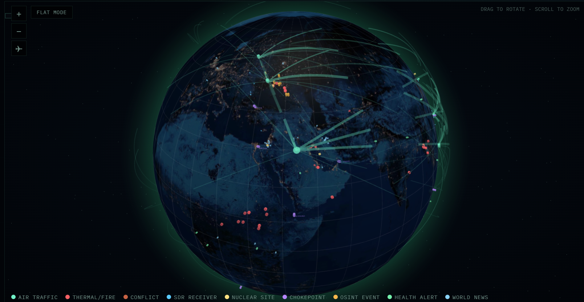

# 🧠 CRUCIX — Open Source Intelligence Terminal


---

## 📖 Оглавление
1. [Описание](#-описание)
2. [Скриншоты](#-скриншоты)
3. [Быстрый старт](#-быстрый-старт)
4. [Что вы получаете](#-что-вы-получаете)
5. [🗺️ Пять карт Crucix — пять измерений реальности](#️-пять-карт-crucix--пять-измерений-реальности)
6. [📊 Аналитическая платформа](#-аналитическая-платформа)
7. [🏗️ Инфраструктурный анализатор](#-инфраструктурный-анализатор)
8. [🔀 Router v3.1 — Механизм А+Б](#-router-v31--механизм-аб)
9. [🧪 AI-лаборатория](#-ai-лаборатория)
10. [🔑 API-ключи](#-api-ключи)
11. [🏛️ Архитектура](#-архитектура)
12. [🧩 Модульная архитектура сервера](#-модульная-архитектура-сервера)
13. [🧭 Система полярности и сверки нарративов](#-система-полярности-и-сверки-нарративов)
14. [Источники данных](#-источники-данных)
15. [npm-скрипты](#-npm-скрипты)
16. [Конфигурация](#-конфигурация)
17. [API-эндпоинты](#-api-эндпоинты)
18. [Устранение неполадок](#-устранение-неполадок)
19. [Расширения](#-расширения)
20. [AI-чат](#-ai-чат)
21. [Вклад в проект](#-вклад-в-проект)
22. [🧠 Прогностическое ядро Crucix](#-прогностическое-ядро-crucix)
23. [📰 SmartScroll — интеграция RSS и Telegram](#-smartscroll--интеграция-rss-и-telegram)
24. [Лицензия](#-лицензия)

## 🚀 Описание

**Crucix** — платформа для сбора, анализа и визуализации данных из открытых источников. Предназначена для мониторинга геополитической, экономической, военной и экологической обстановки в реальном времени.

Архитектура построена по принципу **«Корзина → AI → Карта»**:

- **Сбор** — данные приходят из 226 источников в корзину (`data/basket/`)
- **Анализ** — 59 анализаторов считают индексы, композиты, прогнозы (`data/analytics/`)
- **AI** — локальный LLM (Ollama) генерирует брифы и прогнозы
- **Карта** — результат визуализируется в **5 автономных карт**, каждая из которых отображает свой класс данных

### Ключевые возможности

- ✅ **226 OSINT-источников** — спутники, авиация, конфликты, экономика, экология
- ✅ **59 анализаторов** — индексы, детекторы, прогнозы, композиты
- ✅ **370+ API-модулей** — все эндпоинты данные из корзины
- ✅ **8 категорий аналитики** — index, detector, forecast, semantic, flow, market, specialist, space
- ✅ **5 автономных карт** — Event, Metrics, Semantic, Forecast, Network — каждая со своими слоями, палитрами и моделями визуализации
- ✅ **222 слоя суммарно** — 84 + 75 + 35 + 16 + 12, разнесены по 5 картам по принципу сепарабельности каналов
- ✅ **Инфраструктурный анализатор** — 114 объектов, 15 эндпоинтов
- ✅ **Автообновление** каждые 15 минут через SSE
- ✅ **Telegram + Discord боты** с двухсторонним управлением
- ✅ **AI-аналитика** через Ollama (локально, без облака)
- ✅ **Модульная архитектура** — легко расширять
- ✅ **Zero cloud, zero telemetry, zero subscriptions**

> **Live website:** [https://www.crucix.live/](https://www.crucix.live/)

---

## 📸 Скриншоты

| | |
|-|-|
|||
|**Главный дашборд**|**Анимация загрузки**|

| | |
|-|-|
|||
|**Карта с маркерами**|**3D WebGL-глобус**|

---

## ⚡ Быстрый старт

### Локальный запуск

```bash
# 1. Клонировать репозиторий
git clone https://github.com/calesthio/Crucix.git
cd Crucix

# 2. Установить зависимости (только Express)
npm install

# 3. Скопировать шаблон .env и добавить API-ключи
cp .env.example .env

# 4. Запустить дашборд
npm run dev
```

Дашборд откроется на `http://localhost:3117`

Если `npm run dev` не работает, запустите напрямую:

```bash
node --trace-warnings server.mjs
```

### Docker

```bash
git clone https://github.com/calesthio/Crucix.git
cd Crucix
cp .env.example .env
docker compose up -d
```

---

## 🎯 Что вы получаете

### Дашборд

- **3D WebGL-глобус** (Globe.gl) с атмосферой и звёздным полем
- **2D-карта** (D3) с 9 типами маркеров
- **5 автономных карт** — каждая со своей моделью визуализации, независимыми слоями и локальными границами
- **Анимированные дуги** полётов между авиаузлами
- **Фильтры по регионам** (Мир, Америка, Европа, Ближний Восток, Азия, Африка)
- **Рыночные данные** в реальном времени (индексы, крипто, энергия, металлы)

### Аналитика

- **59 анализаторов** — от базовых индексов до композитных рисков
- **197 стран** в справочнике характеристик
- **147 стран** с реальным коэффициентом Джини
- **194 страны** с макроэкономикой World Bank
- **114 объектов** критической инфраструктуры (25 военных баз, 20 АЭС, 26 портов, 15 чокпоинтов, 15 дамб, 13 энергосетей)
- **8 категорий** аналитики в `data/analytics/`

### AI-возможности

- **Локальный LLM** через Ollama
- **AI-брифы** (daily, alert, summary)
- **Прогнозы** через AI
- **Семантический поиск** по новостям (TF-IDF + cosine similarity)
- **Извлечение сущностей** (NER) из текстов

### Интеграции

- **Telegram-бот** (двухсторонний)
- **Discord-бот** (двухсторонний)
- **MCP Server** (Model Context Protocol) — доступ к Crucix из внешних AI-клиентов
- **CLI-аналитика** — запросы к анализаторам из терминала

---

## 🗺️ Пять карт Crucix — пять измерений реальности

### Почему пять, а не одна

Визуализация данных — это перевод информации в зрительные сигналы, которые мозг способен обработать. Каждый тип данных требует своего «языка»: события требуют точек на карте, числовые показатели — заливки территорий, связи — графа с рёбрами. Когда разные типы данных смешиваются на одном полотне, мозг не справляется — сигналы интерферируют, как два радиоканала на одной частоте.

Это не организационное удобство, а следствие из **теории каналов восприятия** (Munzner, *Visualization Analysis & Design*, 2014, Table 5.3). У человеческого зрения есть ограниченный набор каналов: позиция, цвет, размер, форма, прозрачность. Каждый канал имеет разную «пропускную способность» — способность точно передавать количественные или категориальные значения. Когда два типа данных претендуют на один и тот же канал одновременно, возникает **когнитивная интерференция**: наблюдатель не может отделить один сигнал от другого.

**Принцип сепарабельности каналов** (Munzner 2014) гласит: два визуальных канала сепарабельны, если их можно воспринимать одновременно без взаимных помех. Пять классов данных в Crucix используют пять разных комбинаций каналов:

| Карта | Каналы визуализации | Тип данных | vizType |
|-------|---------------------|-----------|---------|
| **Event Map** | Position + Hue + Shape | Точечные события | `marker` |
| **Metrics Map** | Position + Color intensity | Количественные индикаторы по странам | `choropleth` / `series` |
| **Semantic Map** | Position + Hue (категориальный) + Shape | Тональность и нарративы | `choropleth` (diverging) |
| **Forecast Map** | Position + Color intensity + Transparency | Вероятности с уверенностью | `probability` |
| **Network Map** | Position (force) + Shape + Edge width | Связи и отношения | `graph` (SVG) |

Если бы все пять жили на одной карте, четыре из пяти кодировок пришлось бы либо отключить, либо наложить друг на друга — и ценность каждой упала бы до нуля.

**Простыми словами:** представьте, что вы смотрите на карту мира, где одновременно красными точками отмечены теракты, страны раскрашены по уровню инфляции, поверх наложены стрелки торговых связей, а ещё прозрачность показывает вероятность рецессии. Разобраться в этом невозможно — глаз не может одновременно читать четыре разных «языка». Поэтому каждый язык получает свою карту.

### Принцип автономии

Каждая из пяти карт — **полностью автономна**. Это реализовано через паттерн **Bulkhead** (Nygard, *Release It!*, 2007): если одна карта падает, четыре остальные продолжают работать. Автономность гарантируется шестью правилами (R1–R6):

- **R1:** Ни один `<script>`, `<link>` или `fetch` не выходит за пределы своей папки. Проверка: `grep -rn '\.\./' index.html js/*.js` возвращает 0 строк.
- **R2:** Географические границы (`world.geojson`) лежат локально в `data/` каждой карты.
- **R3:** Файл `layers.js` каждой карты содержит только свои слои — ноль чужих.
- **R4:** Конфигурация (`maps-config.js`, `presets.json`) — своя для каждой карты.
- **R5:** `manifest.json` каждой карты фиксирует `local_cross_map: 0`, `failure_domain: 1`.
- **R6:** Сбой в одной карте не влияет на остальные четыре.

Каждая карта живёт в своей папке: `/dashboard/public/<map-name>/` со своим `index.html`, `js/`, `css/`, `data/`, `presets/`. Нет общих скриптов, общих стилей, общих данных — только общий сервер.

---

### 1. Event Map — Карта событий

**Расположение:** `/dashboard/public/event-map/`
**URL:** `http://localhost:3117/event-map/`
**Слоёв:** 84 в 12 категориях

Event Map — это карта мира, на которой точечными маркерами отображаются конкретные события: протесты, военные инциденты, кибератаки, дипломатические встречи, катастрофы, миграционные волны, вспышки болезней. Каждая точка — одно событие с координатами, временем, категорией и приоритетом.

**Модель данных:** один маркер = одно событие. Тысячи маркеров на карте, сгруппированных в 84 слоя по 12 категориям (конфликты, протесты, катастрофы, кибер, политика, дипломатия, экономика, террор, миграция, здоровье, инфраструктура, социальные). Маркеры кластеризуются при зуме, раскрашиваются по категории, получают popup с детализацией при клике.

**Визуальный канал:** Position + Hue + Shape. Позиция на карте = географические координаты события. Цвет = категория. Форма = тип (круг, треугольник, квадрат).

**Чем отличается от Metrics Map:** Event Map показывает отдельные события (митинг 15 марта в Тбилиси), Metrics Map — агрегированные показатели по странам (уровень безработицы в Грузии = 14%). Событие не сводится к числу, а число не сводится к событию — это разные онтологии.

**Чем отличается от Network Map:** Event Map показывает точки на географической карте. Network Map показывает связи между узлами в абстрактном пространстве графа — там нет широт и долгот.

**Папка:**
```
event-map/
├── index.html
├── manifest.json
├── EVENT-MAP-MANIFEST.md
├── ARCHITECTURE.md
├── AUTONOMY-CHARTER.md
├── css/event-map.css
├── js/
│   ├── core.js
│   ├── countries.js
│   ├── layers.js          ← 84 слоя, 12 категорий
│   ├── maps-config.js
│   ├── map-controls.js
│   ├── markers.js          ← генерация и кластеризация маркеров
│   ├── event-map.js
│   ├── copy-data.js
│   ├── heat-timeline.js
│   ├── ssi.js
│   ├── refresh.js
│   ├── cii.js
│   ├── logger.js
│   └── init.js
├── data/world.geojson
└── presets/presets.json
```

**Маркеры и кластеризация:**
- До 1000+ маркеров на слой, с детерминированным геосдвигом по seed.
- Кластеризация: Leaflet.markercluster с adaptive zoom.
- Приоритизация: 5 уровней (critical → low), влияют на размер и z-index.
- Popup: категория, описание, источник, время, координаты.

**Автономный fallback:**
При отсутствии API данные генерируются локально: 2 маркера на страну × 90 стран = 180 маркеров на слой. Позиция — координаты страны + детерминированный сдвиг. Категория и приоритет — по seed слоя.

---

### 2. Metrics Map — Карта количественных индикаторов

**Расположение:** `/dashboard/public/metrics-map/`
**URL:** `http://localhost:3117/metrics-map/`
**Слоёв:** 75 в 13 категориях

Metrics Map — это choropleth-карта мира, где каждая страна закрашивается цветом, интенсивность которого соответствует значению числового показателя. Инфляция, ВВП, безработица, долг/ВВП, индекс доллара, спреды, кривая доходности, уран, киберугрозы, ESG-метрики, HDI, расходы на оборону — 75 индикаторов в 13 категориях.

**Модель данных:** одна страна = одно значение индикатора. 90 стран на карте, значение классифицируется методом Jenks DP (или Quantile / Equal Interval / Standard Dev / Manual — по домену), затем применяется палитра ColorBrewer (sequential или diverging). Результат — заливка стран с легендой, показывающей пороги классов, метод классификации и качество (GVF).

**Визуальный канал:** Position + Color intensity. Позиция = территория страны. Интенсивность цвета = значение показателя. Эти два канала полностью сепарабельны (Munzner 2014) — позиция передаёт «где», цвет передаёт «сколько».

**Чем отличается от Semantic Map:** Metrics Map показывает количественные показатели (инфляция = 7.2%). Semantic Map показывает категориальную тональность (настроение = «негативное», «нейтральное», «позитивное»). Числа и категории — разные типы данных, и для них нужны разные палитры: sequential (для чисел) и diverging (для категорий с нейтралью посередине).

**Чем отличается от Forecast Map:** Metrics Map отображает текущие, наблюдаемые значения. Forecast Map отображает вероятности будущих событий с дополнительным каналом — прозрачностью, кодирующей уверенность модели. Текущее значение и вероятность будущего — разные семантические сущности.

**Папка:**
```
metrics-map/
├── index.html
├── manifest.json
├── METRICS-MAP-MANIFEST.md
├── ARCHITECTURE.md
├── AUTONOMY-CHARTER.md
├── css/metrics-map.css
├── js/
│   ├── core.js
│   ├── countries.js        ← 90 стран с координатами и статусами
│   ├── layers.js           ← 75 слоёв, 13 категорий
│   ├── maps-config.js      ← методы классификации, палитры, breaks
│   ├── series-adapter.js    ← series → choropleth (14 модулей, spatial proxies)
│   ├── map-controls.js     ← Leaflet init, Jenks DP, ColorBrewer, GVF, legend
│   ├── markers.js          ← 6 marker-слоёв × 180 = 1080 маркеров
│   ├── metrics-map.js      ← decision tree: choropleth / series / marker
│   ├── copy-data.js        ← снапшот ~500 КБ
│   ├── heat-timeline.js
│   ├── ssi.js              ← Strategic Stress Index
│   ├── refresh.js
│   ├── cii.js              ← Country Instability Index (fallback)
│   ├── logger.js
│   └── init.js
├── data/world.geojson      ← локальная копия границ (252 КБ)
└── presets/presets.json    ← 5 пресетов с уникальными ключами
```

**Методы классификации (Jenks 1963, Brewer 2005):**

| Метод | Формула | Применение |
|-------|---------|-----------|
| Jenks DP | минимизация SDCM, \(O(k \cdot n^2)\) | По умолчанию |
| Quantile | равные группы | При выбросах |
| Equal Interval | \((max - min) / k\) | Плавные шкалы |
| Standard Dev | \(\mu \pm 0.5\sigma\), \(\pm 1.5\sigma\) | Нормальное распределение |
| Manual | пороги эксперта | ISM 50, recession 20/40/60/80 |

Контроль качества: \(GVF = (SDAM - SDCM) / SDAM > 0.7\). Типичные значения в Metrics Map: 0.90–0.93.

**Палитры ColorBrewer:**
- Sequential (7): Blues, YlOrRd, Greens, Oranges, Purples, BuPu, OrRd
- Diverging (4): RdYlGn5, RdBu5, BrBG5, PiYG5

Доменные правила: PMI → diverging RdYlGn5 с manual breaks [42, 47, 53, 58] (ISM 50 = граница). Recession → sequential YlOrRd5 с manual breaks [20, 40, 60, 80]. Copper/Gold → diverging RdBu5, Jenks. Yield Curve → diverging RdBu5, Jenks (инверсия = красный).

**Типы слоёв:**
- **Choropleth (56):** заливка стран по значению индикатора. API → fallback (детерминированный seed по `layer.id`, base(status) + noise).
- **Series (14):** рыночные ряды → choropleth через `SeriesAdapter` с spatial proxies (us_market, oil_producers, financial_centers...). 6 трансформаций: weighted_value, stress_indicator, ratio_indicator и др.
- **Marker (6):** точечные маркеры на choropleth-карте (180 маркеров/слой, 1080 при полной активации).

**Автономный fallback:**
При отсутствии API данные генерируются локально из `countries.js`: детерминированный seed по `layer.id`, для каждой из 90 стран значение = base(status) + noise(seed), Jenks классификация, `applyChoropleth()`, логирование GVF.

---

### 3. Semantic Map — Карта семантического анализа

**Расположение:** `/dashboard/public/semantic-map/`
**URL:** `http://localhost:3117/semantic-map/`
**Слоёв:** 35 в 12 категориях

Semantic Map — это карта мира, где страны закрашиваются по тональности текстов: негативная, нейтральная, позитивная. Тональность вычисляется из потоков новостей и социальных медиа по каждому региону. Дополнительно: нарративы, дезинформация, медийный тон, пропаганда, инфовойна, когнитивные искажения, манипуляции, токсичность.

**Модель данных:** одна страна = категориальный класс тональности (5 классов по Cowan 2001: very_negative, negative, neutral, positive, very_positive). 35 слоёв в 12 категориях (тональность, нарративы, дезинформация, медийный тон, пропаганда, инфовойна, соцсети, темы, достоверность, когнитивные искажения, манипуляции, токсичность).

**Визуальный канал:** Position + Hue (категориальный) + Shape. Палитра — diverging RdYlGn5 (красный → жёлтый → зелёный), где середина = нейтральная тональность, края — крайние значения. Для кластеров нарративов — категориальная Set1. Форма маркера (Circle, Square, Triangle, Diamond) — для категориального различения слоёв.

**Чем отличается от Metrics Map:** Metrics Map классифицирует значения по интенсивности (sequential: «чем больше, тем темнее»). Semantic Map классифицирует по категориям с нейтральным центром (diverging: «плохо — нейтрально — хорошо»). Это разные палитры, потому что число 7.2 (инфляция) не имеет «нейтрального» значения, а тональность «нейтральная» — это нулевая точка на шкале.

**Чем отличается от Event Map:** Event Map показывает отдельные события как точки. Semantic Map показывает агрегированную тональность информационного поля по странам как заливку. Событие — это «что произошло». Тональность — это «как об этом пишут».

**Папка:**
```
semantic-map/
├── index.html
├── manifest.json
├── SEMANTIC-MAP-MANIFEST.md
├── ARCHITECTURE.md
├── AUTONOMY-CHARTER.md
├── css/semantic-map.css
├── js/
│   ├── core.js
│   ├── countries.js
│   ├── layers.js           ← 35 слоёв, 12 категорий
│   ├── maps-config.js      ← diverging RdYlGn5, Set1 для кластеров
│   ├── sentiment-adapter.js ← 5 классов тональности (Cowan 2001)
│   ├── map-controls.js     ← Leaflet, diverging choropleth, legend
│   ├── markers.js          ← маркеры по типам (Circle, Square, Triangle, Diamond)
│   ├── semantic-map.js     ← decision tree
│   ├── copy-data.js
│   ├── heat-timeline.js
│   ├── ssi.js
│   ├── refresh.js
│   ├── cii.js
│   ├── logger.js
│   └── init.js
├── data/world.geojson
└── presets/presets.json
```

**Sentiment-adapter:**
5 классов по Cowan 2001: very_negative (0–20%), negative (20–40%), neutral (40–60%), positive (60–80%), very_positive (80–100%). Diverging палитра RdYlGn5: красный → оранжевый → жёлтый → светло-зелёный → зелёный. Нейтральный класс — жёлтый, в центре шкалы.

**Автономный fallback:**
При отсутствии API тональность генерируется из `countries.js`: seed по `layer.id` + `country.status`, 5 классов с взвешенным распределением (neutral доминирует ~40%), diverging заливка, логирование.

---

### 4. Forecast Map — Карта вероятностных прогнозов

**Расположение:** `/dashboard/public/forecast-map/`
**URL:** `http://localhost:3117/forecast-map/`
**Слоёв:** 16, все типа `probability`

Forecast Map — это карта мира, где страны закрашиваются по вероятности наступления события: рецессия, эскалация конфликта, политический кризис, продовольственный кризис. Каждый прогноз сопровождается **двойным кодированием**: цвет = класс вероятности, прозрачность = уверенность модели.

**Модель данных:** одна страна = вероятность (0–100%) + уверенность модели (0–1). 16 слоёв, все типа `probability`. Горизонт прогноза — от 1 месяца до 1 года.

**Визуальный канал:** Position + Color intensity + Transparency. Это **трёхканальная кодировка** — единственная в Crucix, использующая прозрачность как информационный канал, а не как декорацию. Цвет (sequential YlOrRd5, manual breaks [20, 40, 60, 80]) передаёт класс вероятности. Прозрачность (`opacity = 0.4 + 0.5 × confidence`, Cressie 1993, *Statistics for Spatial Data*) передаёт уверенность модели: чем прозрачнее заливка, тем меньше уверенность в прогнозе.

**Простыми словами:** если прогноз рецессии в стране X — 75%, и модель уверена на 90%, вы увидите ярко-красную заливку. Если та же вероятность 75%, но модель уверена лишь на 40%, заливка будет бледно-красной. Глаз сразу видит: «высокая вероятность, но низкая уверенность — прогноз ненадёжный». На обычной choropleth-карте этой информации нет вообще.

**Чем отличается от Metrics Map:** Metrics Map показывает наблюдаемые факты: инфляция = 7.2%. Forecast Map показывает вероятности будущих событий с метаданными о неопределённости. Факт и прогноз — разные эпистемологические сущности. Факт не имеет «уверенности» (он уже случился). Прогноз без указания уверенности — это не прогноз, а догадка.

**Чем отличается от Semantic Map:** Semantic Map использует diverging палитру (двустороннюю: плохо ↔ хорошо). Forecast Map использует sequential палитру (одностороннюю: 0% → 100%) с дополнительным каналом прозрачности. Двусторонняя палитра не подходит для вероятностей, потому что «0% вероятности» — это не «противоположность 100%», а просто нижняя граница шкалы.

**Папка:**
```
forecast-map/
├── index.html
├── manifest.json
├── FORECAST-MAP-MANIFEST.md
├── ARCHITECTURE.md
├── AUTONOMY-CHARTER.md
├── css/forecast-map.css
├── js/
│   ├── core.js
│   ├── countries.js
│   ├── layers.js           ← 16 слоёв, все типа probability
│   ├── maps-config.js      ← manual breaks [20,40,60,80], YlOrRd5, opacity formula
│   ├── forecast-adapter.js ← spatial proxies для 4 источников прогнозов
│   ├── map-controls.js     ← Leaflet, double-encoding (color + opacity), legend
│   ├── markers.js
│   ├── forecast-map.js     ← decision tree
│   ├── copy-data.js
│   ├── heat-timeline.js
│   ├── ssi.js
│   ├── refresh.js
│   ├── cii.js
│   ├── logger.js
│   └── init.js
├── data/world.geojson
└── presets/presets.json
```

**Двойное кодирование (Cressie 1993):**
Цвет: sequential YlOrRd5, manual breaks [20, 40, 60, 80] → 5 классов вероятности (very_low, low, medium, high, very_high). Прозрачность: `opacity = 0.4 + 0.5 × confidence`, где confidence ∈ [0, 1]. При confidence = 1.0 → opacity = 0.9 (яркая заливка). При confidence = 0.0 → opacity = 0.4 (бледная заливка). Порог видимости: при opacity < 0.4 заливка не рисуется.

**Spatial proxies для источников прогнозов:**
4 источника: market_prediction (prediction_markets), model_forecast (байесовские модели), ai_forecast (LLM-агенты), composite (ансамбль). Каждый источник маппится на страны через spatial proxy (us_market, eu_zone, emerging_markets, global_all).

**Автономный fallback:**
При отсутствии API данные генерируются локально: вероятность = base(status) + noise(seed), confidence = 0.5 + noise(seed) × 0.3, классификация по manual breaks, двойная заливка (цвет + прозрачность), логирование.

---

### 5. Network Map — Карта связей и отношений

**Расположение:** `/dashboard/public/network-map/`
**URL:** `http://localhost:3117/network-map/`
**Слоёв:** 12, тип `graph` (SVG force-directed)

Network Map — это не географическая карта. Это **граф связей**, визуализированный через force-directed simulation в SVG. Узлы — страны, организации, финансовые потоки, киберсети. Рёбра — торговые связи, санкционные отношения, миграционные потоки, финансовые каналы. Здесь нет широт и долгот; позиция узла вычисляется физической симуляцией.

**Модель данных:** узлы (entities) + рёбра (relations). 12 слоёв в категориях (кибер-сети, торговля, финансы, миграция, дипломатия, энергетика). Узлы имеют тип (Circle, Square, Triangle, Diamond) и размер (пропорционален Degree centrality). Рёбра имеют ширину (пропорциональна весу связи) и цвет (тип отношения).

**Визуальный канал:** Position (force) + Shape + Edge width. Позиция — не географическая, а топологическая: вычисляется force simulation (кулоновское отталкивание между узлами, гуково притяжение вдоль рёбер, интеграция Верле). Форма узла — категориальный тип (Circle = страна, Square = организация, Triangle = финансовый центр, Diamond = киберузел). Ширина ребра — вес связи.

**Почему Network Map не использует Leaflet и world.geojson:**
Географическая карта (Leaflet + GeoJSON) кодирует позицию через широту и долготу. Но для графа связей географическая позиция — не главное; главное — топология (кто с кем связан, кто центральный, кто периферийный). Force-directed layout размещает связанные узлы рядом, а несвязанные — далеко, независимо от их реального положения на Земле. Если бы мы использовали Leaflet, узлы застряли бы в своих географических координатах и структура связей стала бы нечитаемой.

**Простыми словами:** если Event Map — это карта мира с точками, а Metrics Map — это карта мира с заливкой, то Network Map — это «карта паутины», где связи важнее местоположения. Вы видите, кто связан с кем, кто в центре, кто на периферии, через какие узлы проходит больше всего путей. Это невозможно показать на обычной карте.

**Чем отличается от остальных четырёх карт:**
Network Map — единственная карта без Leaflet и без `world.geojson`. Вместо растрового рендеринга — SVG force-directed graph. Вместо географических координат — топологическая симуляция. Вместо choropleth или marker — рёбра и узлы. Панель досье показывает метрики графа (Degree, Betweenness, PageRank) вместо индикаторов страны.

**Папка:**
```
network-map/
├── index.html
├── manifest.json
├── NETWORK-MAP-MANIFEST.md
├── ARCHITECTURE.md
├── AUTONOMY-CHARTER.md
├── css/network-map.css
├── js/
│   ├── core.js
│   ├── countries.js        ← справочник узлов (стран, организаций)
│   ├── layers.js           ← 12 слоёв графа
│   ├── network-config.js  ← force simulation параметры (alpha, charge, link distance)
│   ├── graph-engine.js    ← force simulation: Coulomb repulsion, Hooke attraction, Verlet
│   ├── graph-renderer.js   ← SVG рендеринг: узлы, рёбра, метки
│   ├── graph-panel.js      ← панель досье: Degree, Betweenness, PageRank
│   ├── network-map.js      ← decision tree
│   ├── copy-data.js
│   ├── refresh.js
│   ├── logger.js
│   └── init.js
├── data/
│   └── nodes.json          ← справочник узлов (без world.geojson)
└── presets/presets.json
```

**Force simulation (Barabási 2016, *Network Science*):**
- **Repulsion:** кулоновское отталкивание, `F = k² / d` (Fruchterman-Reingold 1991), где k — идеальная длина связи, d — расстояние.
- **Attraction:** гуково притяжение вдоль рёбер, `F = d² / k`.
- **Integration:** Verlet (velocity-free), `x_new = 2·x − x_prev + a·dt²`.
- **Cooling:** alpha decay от 1.0 до 0.001 за 300 итераций.
- **Стабилизация:** симуляция останавливается при alpha < 0.005.

**4 формы узлов:**
- Circle — страна (90 узлов)
- Square — международная организация
- Triangle — финансовый центр
- Diamond — киберузел

**Метрики графа (панель досье):**
- **Degree centrality** — количество прямых связей узла.
- **Betweenness centrality** — доля кратчайших путей через узел (Freeman 1977).
- **PageRank** — итеративная метрика важности (Page et al. 1999), damping = 0.85.

**Автономный fallback:**
При отсутствии API граф генерируется локально: seed по `layer.id`, 30–60 узлов из справочника, рёбра по weighted random (preferential attachment, Barabási-Albert), force simulation запускается на клиенте.

---

### Сводная таблица пяти карт

| Параметр | Event Map | Metrics Map | Semantic Map | Forecast Map | Network Map |
|----------|-----------|-------------|--------------|--------------|-------------|
| **Папка** | `event-map/` | `metrics-map/` | `semantic-map/` | `forecast-map/` | `network-map/` |
| **Слоёв** | 84 | 75 | 35 | 16 | 12 |
| **Категорий** | 12 | 13 | 12 | 1 | 6 |
| **vizType** | `marker` | `choropleth` / `series` | `choropleth` (diverging) | `probability` | `graph` (SVG) |
| **Каналы** | Position + Hue + Shape | Position + Color intensity | Position + Hue (кат.) + Shape | Position + Color + Transparency | Position (force) + Shape + Edge |
| **Палитра** | категориальная | sequential + diverging | diverging RdYlGn5, Set1 | sequential YlOrRd5 + opacity | категориальная (формы узлов) |
| **Карта** | Leaflet + GeoJSON | Leaflet + GeoJSON | Leaflet + GeoJSON | Leaflet + GeoJSON | SVG (без Leaflet, без GeoJSON) |
| **Тип данных** | События (точки) | Числа (агрегаты по странам) | Категории (тональность) | Вероятности + уверенность | Связи (граф) |
| **Fallback** | 180 маркеров/слой | 90 стран, Jenks, GVF | 90 стран, diverging | 90 стран, double-encoding | 30–60 узлов, preferential attachment |
| **Failure domain** | 1 | 1 | 1 | 1 | 1 |

### Почему карты не могут быть вместе — научное обоснование

#### 1. Когнитивная интерференция каналов

Человеческое зрение способно одновременно обрабатывать 2–3 визуальных канала, но только если они **сепарабельны** — не конкурируют за одни и те же зрительные ресурсы (Munzner 2014, §5.3). Position и Color intensity — сепарабельны. Color intensity и Transparency — **не сепарабельны**: мозг не может отделить «темнее потому что значение выше» от «темнее потому что слой менее прозрачный». Поэтому Forecast Map использует transparency осознанно — как единственный слой, кодирующий неопределённость, и только потому, что probability — единственный тип данных, где неопределённость — часть семантики, а не шум.

Если бы мы попытались наложить choropleth (Metrics) поверх marker (Event), обе кодировки использовали бы позицию на карте, и мозг не смог бы отделить «где событие» от «где заканчивается страна». Результат — визуальный шум, в котором ни один паттерн не считывается.

#### 2. Различие моделей данных

Пять карт — это пять разных **моделей данных**, каждая со своей онтологией:

- **Событие** — точка в пространстве-времени. Сущность: «что-то произошло здесь и сейчас». Атрибуты: координаты, время, категория, приоритет.
- **Индикатор** — число, агрегированное по территории. Сущность: «показатель страны на дату». Атрибуты: значение, единица, период.
- **Тональность** — категория, вычисленная из текстов. Сущность: «как об этом говорят». Атрибуты: класс (5 уровней), источник, confidence.
- **Прогноз** — вероятность будущего события с неопределённостью. Сущность: «что может произойти и насколько мы уверены». Атрибуты: вероятность, горизонт, confidence.
- **Связь** — отношение между сущностями. Сущность: «кто с кем связан». Атрибуты: узлы, рёбра, веса, типы.

Эти модели не сводятся друг к другу. Событие нельзя «усреднить» до индикатора, не потеряв временную и пространственную точность. Индикатор нельзя «раскластеризовать» до событий. Прогноз нельзя «наблюдать» как факт. Связь нельзя «покрасить» как choropleth. Каждая модель требует своего визуального языка, и эти языки несовместимы.

#### 3. Принцип Separation of Concerns (Dijkstra 1974)

Разделение на пять карт — это и архитектурное решение. Каждая карта имеет свой DAG загрузки, свой набор скриптов, свой CSS, свой `manifest.json`, свой `layers.js`. Сбой в одной карте (ошибка в `layers.js`, упавший API, сломанный fallback) не распространяется на остальные. Это паттерн Bulkhead (Nygard 2007): изоляция доменов отказа.

Если бы все слои жили в одном `layers.js` (84 + 75 + 35 + 16 + 12 = 222 слоя), любая синтаксическая ошибка в одном слое уронила бы все 222. С пятью картами ошибка в одном слое Event Map оставляет Metrics, Semantic, Forecast и Network полностью работоспособными.

#### 4. Объяснение для дилетанта

Представьте, что вы работаете в аэропорту и вам нужно одновременно:
1. Отслеживать каждый самолёт на радаре (события — Event Map)
2. Видеть загрузку каждого терминала в процентах (метрики — Metrics Map)
3. Понимать, как пассажиры оценивают сервис (тональность — Semantic Map)
4. Знать вероятность задержек рейсов завтра (прогноз — Forecast Map)
5. Видеть схему маршрутов авиакомпаний (связи — Network Map)

Можно ли всё это нарисовать на одном экране? Технически — да. Но вы ничего не поймёте: точки самолётов будут мешать видеть заливку терминалов, стрелки маршрутов закроют радар, а прозрачность прогноза будет конфликтовать с цветом метрик. Поэтому каждый тип информации получает свой экран. Пять экранов — не потому что так удобнее, а потому что иначе данные становятся невидимыми.

---

## 📊 Аналитическая платформа

В Crucix встроена **полноценная аналитическая платформа** — 59 анализаторов, разделённые на **8 категорий**.

### Категории анализаторов

| Категория | Описание | Кол-во |
|---|---|---|
| **index** | Индексы (страновые, региональные) | 2 |
| **detector** | Детекторы событий и аномалий | 8 |
| **forecast** | Прогностические модели | 4 |
| **semantic** | Семантический анализ текстов | 6 |
| **flow** | Потоки (торговля, миграция, ресурсы) | 10 |
| **market** | Рыночные индикаторы | 7 |
| **specialist** | Специализированные (инфра, ядер, санкции) | 21 |
| **space** | Космос | 1 |
| **ИТОГО** | | **59** |

### Ключевые анализаторы

**Индексы (index):**
- `country-instability` — Индекс нестабильности страны (CII). Эталон внедрения.
- `resilience-index` — Индекс устойчивости (197 стран, 152 уникальных балла)

**Композиты (specialist):**
- `strategic-risk-composite` — Стратегический риск (инстабильность + дефицит устойчивости + инфраструктура + геополитика)
- `infrastructure-cascade` — Каскадный анализ инфраструктуры (13 файлов, 15 эндпоинтов)

**Прогнозы (forecast):**
- `conflict-escalation-tracker` — Эскалация конфликтов (6 уровней)
- `ai-forecasts` — Прогнозы через LLM
- `social-briefing` — Брифы через LLM (daily, alert, summary)
- `central-bank-predictor` — Прогноз действий центробанков

**Детекторы (detector):**
- `geo-convergence` — Конвергенция по географии
- `threat-classification` — Классификация угроз
- `surge-detection` — Всплески аномалий
- `focal-point-detection` — Фокусные точки активности
- `baseline-alerting` — Пороговые уведомления
- `cyber-attack-monitor` — Кибератаки
- `snapshot-system` — Снимки состояния
- `pizza-index` — Активность у штаб-квартир (внутренний индекс)

**Семантика (semantic):**
- `adaptive-news-clustering` — Кластеризация новостей (TF-IDF)
- `ai-news-synthesis` — AI-синтез новостей
- `entity-extraction` — NER
- `multi-source-corroboration` — Проверка фактов
- `source-credibility` — Достоверность источников
- `social-sentiment-analyzer` — Тональность соцсетей

**Потоки (flow):**
- `cross-stream-correlation` — Кросс-корреляция потоков данных
- `route-explorer` — Альтернативные маршруты
- `supply-chain-cascade-engine` — Каскады цепочек поставок
- `supply-chain-resilience` — Устойчивость поставок
- `tanker-fleet-monitor` — Танкерный флот (тёмные суда)
- `arms-transfer-tracker` — Передача вооружений
- `diplomatic-tracker` — Дипломатическая активность
- `migration-flow-tracker` — Миграционные потоки
- `signal-aggregator` — Агрегация сигналов
- `risk-signal-aggregator` — Агрегация рисков

**Рынки (market):**
- `market-composite` — Рыночный композит (VIX, нефть, золото, DXY)
- `derived-market-analytics` — Производные метрики (Gold/Oil, Copper/Gold)
- `energy-market-intelligence` — Энергетические рынки
- `prediction-markets` — Прогнозные рынки
- `stablecoin-monitor` — Стейблкоины
- `etf-flow-analysis` — Потоки ETF
- `fx-reserves-monitor` — Валютные резервы
- `tick-data-analyzer` — Тиковые данные

**Специалисты (specialist) — продолжение:**
- `sanctions-pressure` — Санкционное давление
- `political-stability-monitor` — Политическая стабильность
- `food-security-monitor` — Продовольственная безопасность

**Космос (space):**
- `satellite-analyzer` — Анализ спутников

### Как работает анализ

1. **Сбор** — сборщики (`scripts/collectors/`) кладут данные в корзину `data/basket/`
2. **Расчёт** — анализаторы (`scripts/analyzers/`) читают корзину + справочники, считают индексы, пишут в `data/analytics/{category}/`
3. **Отдача** — API-модули (`apis/sources/{name}-api.mjs`) читают результаты, отдают через `/api/layers/{name}`
4. **Отображение** — слой на одной из 5 карт (`dashboard/public/<map-name>/js/layers.js`) показывает результат

### Структура `data/analytics/`

```
data/analytics/
├── _manifest.json     # реестр всех анализаторов
├── _catalog.json      # каталог классов
├── _lineage.json      # происхождение данных
├── _health.json       # статус
├── _schema.json       # схема
├── index/             # индексы
├── detector/          # детекторы
├── forecast/          # прогнозы
├── semantic/          # семантика
├── flow/              # потоки
├── market/            # рынки
├── specialist/        # специалисты
└── space/             # космос
```

### Запуск анализатора

```bash
# Один анализатор
node scripts/analyzers/resilience-index.mjs

# Все анализаторы (вручную)
for f in scripts/analyzers/*.mjs; do node "$f"; done

# Полный цикл: сбор → анализ → отдача
node scripts/collectors/collect-worldbank.mjs
node scripts/analyzers/strategic-risk-composite.mjs
curl http://localhost:3117/api/layers/strategic-risk-composite/stats
```

---

## 🏗️ Инфраструктурный анализатор

**Infrastructure Cascade** — самый сложный анализатор в Crucix. Состоит из **13 файлов** и отдаёт **15 эндпоинтов**.

### Файлы

**Блок A (ядро):**
- `infrastructure-graph-core.mjs` — граф, haversine
- `infrastructure-propagation.mjs` — каскадное распространение
- `infrastructure-pagerank-critical.mjs` — PageRank, междуness
- `infrastructure-temporal.mjs` — temporal decay

**Блок B (расчёт):**
- `infrastructure-vulnerability-calc.mjs` — адаптивный расчёт уязвимости
- `infrastructure-monte-carlo.mjs` — Monte Carlo, sensitivity
- `infrastructure-scenario-engine.mjs` — 8 сценариев (Ормуз, Тайвань, АЭС...)

**Блок C (мониторинг):**
- `infrastructure-military-monitor.mjs` — военные базы
- `infrastructure-chokepoint-monitor.mjs` — проливы, каналы
- `infrastructure-nuclear-monitor.mjs` — АЭС
- `infrastructure-supply-chain.mjs` — HHI концентрация
- `infrastructure-cargo-anomaly.mjs` — аномалии грузопотоков

**+ `infrastructure-api.mjs`** — HTTP-обработчик

### Объекты инфраструктуры

`data/infrastructure/objects.json` — **114 объектов:**

- 25 военных баз (США, Россия, Китай, НАТО)
- 20 АЭС (Запорожская, Фукусима, Бушер, Аккую...)
- 26 портов (Шанхай, Сингапур, Роттердам...)
- 15 чокпоинтов (Ормуз, Суэц, Тайвань, Баб-эль-Мандеб...)
- 15 дамб (Три ущелья, Итайпу, Каховская...)
- 13 энергосетей (Восточный Китай, ERCOT, Укрэнерго...)

### 15 эндпоинтов

```
GET /api/layers/infrastructure-api                    — корень
GET /api/layers/infrastructure-api/vulnerability      — уязвимость
GET /api/layers/infrastructure-api/cascade            — каскад
GET /api/layers/infrastructure-api/simulate           — симуляция
GET /api/layers/infrastructure-api/critical-paths     — критические пути
GET /api/layers/infrastructure-api/pagerank           — PageRank
GET /api/layers/infrastructure-api/sensitivity        — чувствительность
GET /api/layers/infrastructure-api/featurecollection  — GeoJSON
GET /api/layers/infrastructure-api/stats              — статистика
GET /api/layers/infrastructure-api/military           — военные объекты
GET /api/layers/infrastructure-api/chokepoints        — проливы
GET /api/layers/infrastructure-api/nuclear            — АЭС
GET /api/layers/infrastructure-api/supply-chain       — цепочки поставок
GET /api/layers/infrastructure-api/cargo-anomalies    — аномалии
GET /api/layers/infrastructure-api/scenarios          — сценарии
```

### Ключевые результаты

- **PageRank → chokepoint-taiwan** (самый связанный узел)
- **Top bottleneck → chokepoint-malacca**
- **Vulnerability max → npp-zaporizhzhia**
- **Sensitivity → exposure** (наиболее влияющий фактор)
- **Сценарий Тайвань-блокада → 3 узла затронуто**
- **Сценарий Ормуз-закрытие → 5 узлов затронуто**

---

## 🔀 Router v3.1 — Механизм А+Б

**Router** (`server/router.mjs`) — ключевой компонент. Определяет, какой модуль обработает запрос.

### 4 механизма поиска

**1. Механизм А (приоритет) — `export const route`:**

API-модуль сам декларирует префикс:
```javascript
export const route = '/api/layers/infrastructure-api';
export default handleInfrastructureAPI;
```

Router при загрузке модуля читает `module.route` и регистрирует в `modulePrefixCache`. Все последующие запросы к `/api/layers/infrastructure-api/*` идут **микросекундно** из кэша.

**2. routes-api.json — точное совпадение:**

Запись `{ path: '/api/layers/country-instability', module: 'country-instability-api' }`. Работает для legacy-модулей.

**3. routes-api.json — wildcard:**

Запись `{ path: '/api/layers/infrastructure-api/*', module: 'infrastructure-api' }`. Работает как fallback.

**4. Механизм Б — авто-префикс:**

Если файл в `apis/sources/` называется `{name}-api.mjs` — автоматически доступен через `/api/layers/{name}/*`. Для 300+ legacy-модулей.

### Приоритет поиска

1. `modulePrefixCache` (Механизм А) — самый быстрый
2. `routes-api.json (exact)` — точное совпадение
3. `routes-api.json (wildcard)` — с учётом `*`
4. `autoPrefixCache` (Механизм Б) — по имени файла

### Для разработчика

**Новый API-модуль** — рекомендуется добавить `export const route` (Механизм А):

```javascript
// apis/sources/my-module-api.mjs
export const route = '/api/layers/my-module';

export default async function handler(req, res) {
  // ...
}
```

**Больше не нужно** добавлять запись в `routes-api.json` вручную. Модуль сам регистрируется.

---

## 🧪 AI-лаборатория

Лаборатория ИИ — среда, где локальный LLM (Ollama) становится активным участником анализа.

### Компоненты

- **Ollama** — `http://localhost:11434`, модели: llama3.1:8b, mistral:7b, phi3:3.8b
- **AI Gateway** — `apis/sources/ai-gateway.mjs`
- **RAG-модуль** — `apis/sources/rag-module/`, порт 3120
- **AI Chat** — `http://localhost:8080`

### Pipeline AI-лаборатории

1. **Сбор данных** → `data/basket/*.json`
2. **Расчёт анализаторов** → `data/analytics/{category}/*.json`
3. **Отдача через API** → `GET /api/layers/{name}`
4. **AI-прогнозирование** → `data/analytics/forecast/*.json`
5. **Генерация брифа** → `daily-briefing.mjs` через Ollama
6. **Семантический поиск** → RAG-модуль на порту 3120

### AI-модули

- **ai-news-synthesis** — синтез новостей через LLM
- **ai-forecasts** — вероятностный прогноз
- **social-briefing** — 3 формата брифов (daily, alert, summary)
- **daily-briefing.mjs** — ежедневный дайджест

---

## 🔑 API-ключи

Crucix **работает без API-ключей** — используются только открытые источники. Правило проекта (12.2): запрет на регистрации, ключи, OAuth.

### Открытые источники (без ключей)

- **USGS Earthquakes** — землетрясения
- **NOAA SWPC** — космическая погода
- **OpenSky Network** — самолёты (анонимно)
- **Open-Meteo** — погода
- **Where the ISS at** — МКС
- **Launch Library 2** — космические запуски
- **Frankfurter** — курсы валют ЕЦБ
- **Hacker News** — топ-новости
- **mledoze/countries** — справочник 250 стран
- **CISA KEV** — уязвимости
- **CoinGecko** — крипта
- **US Treasury** — долг США
- **ECB Data Portal** — макро ЕС
- **World Bank** — макро 197 стран
- **GDELT** — новости (требует browser User-Agent, пауза ≥5 сек)

### Если всё-таки нужен ключ

Один ключ (может пригодиться): `OLLAMA_HOST` для внешнего Ollama. Это локально — регистрация не нужна.

---

## 🏛️ Архитектура

### Принцип «Корзина → AI → Карта»

```
Внешний API
    ↓
Сборщик (scripts/collectors/collect-*.mjs)
    ↓
Корзина (data/basket/*.json)
    ↓
Анализатор (scripts/analyzers/*.mjs)
    ↓
Аналитика (data/analytics/{category}/*.json)
    ↓
API-модуль (apis/sources/*-api.mjs)
    ↓
Карта (dashboard/public/<map-name>/)
```

### Ключевое правило

**Ни один модуль не делает fetch к внешним API.** Все данные только из корзины. Единственное исключение — сборщики, которые наполняют корзину.

### Структура проекта

```
Crucix/
├── apis/sources/            # 370+ API-модулей
├── scripts/
│   ├── collectors/          # сборщики в корзину
│   └── analyzers/           # анализаторы
├── data/
│   ├── basket/              # 226 файлов данных
│   ├── analytics/           # 8 категорий аналитики
│   ├── infrastructure/      # 114 объектов
│   ├── reference/           # справочники (197 стран, Джини)
│   └── geo/                 # world.geojson, country-coords
├── server/                  # серверные модули
│   ├── router.mjs           # роутер v3.1
│   ├── loader.mjs           # загрузчик модулей
│   ├── modules.json         # 370+ модулей
│   ├── routes-api.json      # legacy-маршруты
│   └── server.mjs           # точка входа
├── dashboard/public/        # страницы и 5 карт
│   ├── event-map/           # 84 слоя, маркеры
│   ├── metrics-map/         # 75 слоёв, choropleth
│   ├── semantic-map/        # 35 слоёв, sentiment
│   ├── forecast-map/        # 16 слоёв, probability
│   └── network-map/         # 12 слоёв, SVG-граф
├── docs/help/               # справки ru/en
├── ai-memory-sync/          # файлы памяти AI
└── logs/collectors/         # логи сборщиков
```

---

## 🧩 Модульная архитектура сервера

Все серверные файлы в `server/`:

- `server.mjs` — точка входа (30 строк)
- `router.mjs` — API-роутер (Механизм А+Б)
- `loader.mjs` — загрузчик модулей из `modules.json`
- `api.mjs` — API-маршруты (реестр и др.)
- `pages.mjs` — маршруты страниц
- `utils.mjs` — утилиты (`sendJSON`, `sendError`)
- `config.mjs` — порт, MIME-типы
- `static.mjs` — раздача статики
- `modules.json` — реестр API-модулей (370+)
- `routes-api.json` — API-маршруты (legacy)
- `pages.json` — реестр страниц
- `routes-pages.json` — маршруты страниц

---

## 🧭 Система полярности и сверки нарративов

**Версия:** 1.0 · **Добавлено:** 22–23.09.2026

### Что это

Система, которая **вычисляет геополитическую полярность из данных** и **сверяет российский и западный нарративы по заданной теме**. Не пропаганда — сравнительный анализ фреймингов (comparative framing analysis) на наблюдаемых данных.

**Ключевой принцип:** полюс **вычисляется**, а не задаётся списком. Если данные изменятся — полюс изменится автоматически.

### Компоненты

| Файл | Тип | Назначение |
|------|-----|------------|
| `apis/sources/pole-tracker-api.mjs` | API | Вычисляет полярность стран из 8 basket-индикаторов |
| `apis/sources/narrative-splitter-api.mjs` | API | Сверяет российский и западный нарративы по теме |
| `apis/sources/source-camps.json` | Конфиг | Маппинг источников и baseline стран по полюсам |
| `dashboard/public/pole-map.html` | Страница | Карта полюсов: страны, confidence, векторы |
| `dashboard/public/narrative-arena.html` | Страница | Сверка нарративов: Россия / Запад / Расхождения |
| `scripts/snapshot-rsshub.mjs` | Скрипт | Накопление истории новостей (systemd timer) |

### Страницы

- **🌐 Карта полюсов** — [http://localhost:3117/pole-map](http://localhost:3117/pole-map)
  Показывает три полюса (russian / western / non_aligned) со странами, индекс полярности, векторы (санкции, инфовойна, военное присутствие), basket-статус.

- **⚡ Сверить нарративы** — [http://localhost:3117/narrative-arena](http://localhost:3117/narrative-arena)
  Три колонки: российский нарратив / западный нарратив / расхождения. Пресеты: санкции, Украина, энергопереход, конфликт, газ.

### API-эндпоинты

```bash
# Все полюса
curl http://localhost:3117/api/layers/pole-tracker

# Одна страна детально
curl "http://localhost:3117/api/layers/pole-tracker?country=russia"

# Сверка нарративов по теме
curl -G http://localhost:3117/api/layers/narrative-splitter \
    --data-urlencode "topic=Украина" \
    --data-urlencode "limit=10"

# Детальный вывод
curl "http://localhost:3117/api/layers/narrative-splitter?topic=санкции&detail=true"
```

### Что означают термины

| Термин | Смысл |
|--------|-------|
| **silence** | Одна сторона пишет (N>0), другая молчит (0). Сильнейший сигнал замалчивания |
| **framing_gap** | Обе стороны пишут, но с разным фреймингом |
| **double_standard** | Дисбаланс освещения >3x в одну сторону |
| **polarity_index** | 0..1: 0 = однополярный мир, 1 = максимальная полярность |
| **confidence** | 0..0.98: уверенность в классификации страны |
| **basis** | Источник классификации: `baseline_plus_data` / `data_driven` / `weak_signals` / `no_data` |

### Накопление истории

Скрипт `scripts/snapshot-rsshub.mjs` запускается по **systemd timer каждый час в 02 минуты**:

- Обновляет `data/basket/rsshub.json` через `collect-rsshub.mjs`
- Копирует снимок в `data/analytics/rss-history/rsshub-<timestamp>.json`
- Ведёт индекс `index.json`
- Обрезает архив до 168 снимков (7 дней)

```bash
# Управление таймером
systemctl --user status crucix-rsshub-snapshot.timer
systemctl --user list-timers crucix-rsshub-snapshot.timer
tail -20 logs/rss-history/systemd.log

# Ручной запуск
node scripts/snapshot-rsshub.mjs
```

**Зачем:** через неделю накопится 84 000 items — достаточно для реального анализа co-occurrence тем (threat inflation, selective framing).

### Справки

Полные справки по каждой странице и модулю:
- `data/help/ru/pole-tracker-api.txt` — API модуля полярности
- `data/help/ru/narrative-splitter-api.txt` — API модуля сверки
- `data/help/ru/pole-map.txt` — страница карты полюсов
- `data/help/ru/narrative-arena.txt` — страница сверки нарративов
- `data/help/ru/CRUCIX_POLARITY_OVERVIEW.txt` — общий обзор системы

---

## Источники данных

### Справочники
- `data/reference/country-characteristics.json` — **197 стран**
- `data/reference/gini-index.json` — **147 стран с Джини**
- `data/reference/country-aliases.json` — 152 алиаса
- `data/reference/rest-countries.json` — 250 стран (mledoze)

### Технологии и кибербезопасность
- `cisa-kev.json` — известные уязвимости
- `cve.json` — CVE
- `botnets.json` — ботнеты
- `ransomware.json` — ransomware

### Прочее
- `hackernews-top.json` — HN
- `cables_24.json` — подводные кабели
- `pipelines_24.json` — трубопроводы
- `datacenters.json` — датацентры

---

## 📜 npm-скрипты

```bash
npm run dev              # запуск сервера (порт 3117)
npm run collect          # запуск всех сборщиков
npm run analyze          # запуск всех анализаторов
npm run daily-briefing   # генерация ежедневного брифа
npm run registry         # генерация реестра
```

---

## ⚙️ Конфигурация

### Переменные окружения

Скопируйте `.env.example` в `.env`. Основные переменные:

- `PORT` — порт сервера (по умолчанию 3117)
- `OLLAMA_HOST` — URL Ollama (по умолчанию `http://localhost:11434`)
- `TELEGRAM_BOT_TOKEN` — токен бота (опционально)
- `DISCORD_WEBHOOK_URL` — webhook Discord (опционально)

### Важно

**Crucix работает без API-ключей.** Все источники — открытые. Если ключ нужен — его нет в проекте, используйте альтернативы.

---

## 🔌 API-эндпоинты

### Основные

- `GET /api/registry/` — реестр модулей
- `GET /api/geo/markers` — маркеры карты
- `GET /api/geo/status` — статус
- `GET /api/layers` — список слоёв

### Аналитические

**Индексы:**
- `GET /api/layers/country-instability/stats`
- `GET /api/layers/resilience-index/stats`

**Композиты:**
- `GET /api/layers/strategic-risk-composite/stats`
- `GET /api/layers/strategic-risk-composite/top?n=10`
- `GET /api/layers/strategic-risk-composite/bottom?n=10`

**Инфраструктура:**
- `GET /api/layers/infrastructure-api/stats`
- `GET /api/layers/infrastructure-api/military`
- `GET /api/layers/infrastructure-api/nuclear`
- `GET /api/layers/infrastructure-api/chokepoints`
- `GET /api/layers/infrastructure-api/scenarios`
- ...и ещё 10 эндпоинтов

**Рынки:**
- `GET /api/layers/market-composite/score`
- `GET /api/layers/derived-market-analytics/stats`
- `GET /api/layers/energy-market-intelligence/stats`

**Прогнозы:**
- `GET /api/layers/conflict-escalation-tracker/stats`
- `GET /api/layers/social-briefing/text`
- `GET /api/layers/ai-forecasts/stats`

**Детекторы:**
- `GET /api/layers/geo-convergence/stats`
- `GET /api/layers/threat-classification/stats`
- `GET /api/layers/surge-detection/stats`
- `GET /api/layers/focal-point-detection/stats`

**Семантика:**
- `GET /api/layers/adaptive-news-clustering/stats`
- `GET /api/layers/ai-news-synthesis/stats`
- `GET /api/layers/entity-extraction/stats`
- `GET /api/layers/source-credibility/stats`

**Потоки:**
- `GET /api/layers/cross-stream-correlation/stats`
- `GET /api/layers/route-explorer/stats`
- `GET /api/layers/tanker-fleet-monitor/stats`
- `GET /api/layers/arms-transfer-tracker/stats`

**Специалисты:**
- `GET /api/layers/sanctions-pressure/stats`
- `GET /api/layers/political-stability-monitor/stats`
- `GET /api/layers/food-security-monitor/stats`

**Системные:**
- `GET /api/layers/mcp-server/stats`
- `GET /api/layers/crucix-doctor/stats`
- `GET /api/layers/module-registration-controller/stats`
- `GET /api/layers/watchdog/stats`

---

## 🔧 Устранение неполадок

### Сервер не запускается

- Проверить `node --version` — нужен Node 22+
- Проверить `npm install`
- Проверить лог `/tmp/crucix-server.log`

### Анализатор не работает

- `node scripts/analyzers/{name}.mjs` — проверить вывод
- `curl http://localhost:3117/api/layers/{name}/stats` — проверить эндпоинт
- Проверить `data/analytics/{category}/{name}.json` — создан ли файл

### Сборщик возвращает 0 данных

- Проверить источник: `curl <api-url>` — отвечает ли?
- Проверить лог `logs/collectors/collect-{name}.log`
- Некоторые источники требуют User-Agent браузера (GDELT)

### Карта не загружается

- Проверить `data/world.geojson` в папке карты — существует ли файл
- Проверить консоль браузера — нет ли 404 на скрипты
- Проверить порядок скриптов в `index.html` — нарушение DAG = падение
- Проверить автономность: `grep -rn '\.\./' index.html js/*.js` — 0 строк

---

## 📦 Расширения

### Как добавить новый слой на карту

1. **Анализатор** — `scripts/analyzers/{id}.mjs` (читает корзину, пишет в `data/analytics/`)
2. **API-модуль** — `apis/sources/{id}-api.mjs` с `export const route = '/api/layers/{id}'`
3. **Регистрация** — `server/modules.json`: `{ "id": "{id}-api", "path": "./apis/sources/{id}-api" }`
4. **Слой** — `dashboard/public/<map-name>/js/layers.js` (массив `allLayers`):
   ```javascript
   { id: '{id}', name: 'Название', color: '#цвет', icon: '🎯', category: 'категория', vizType: 'marker' }
   ```
5. **Перезапуск сервера**

### Как создать новый сборщик

1. Файл `scripts/collectors/collect-{name}.mjs`
2. Импорт из открытого API (без ключа)
3. Сохранение в `data/basket/{name}.json`
4. Лог в `logs/collectors/collect-{name}.log`
5. Регистрация в cron

### Как добавить новую карту

Если нужно создать шестую карту для нового класса данных:

1. Создать папку `dashboard/public/<new-map-name>/`
2. Создать `index.html` с DAG загрузки (по образцу существующих карт)
3. Создать `js/` с 15+ файлами (core, countries, layers, maps-config, adapter, map-controls, markers, map.js, copy-data, heat-timeline, ssi, refresh, cii, logger, init)
4. Создать `css/<new-map-name>.css` — единственный CSS
5. Создать `data/world.geojson` — локальная копия границ (если карта географическая)
6. Создать `presets/presets.json` — пресеты
7. Создать `manifest.json` с `mapType`, `layers`, `local_cross_map: 0`, `failure_domain: 1`
8. Создать `<NEW-MAP>-MANIFEST.md` — полный манифест состояния
9. Создать `ARCHITECTURE.md` и `AUTONOMY-CHARTER.md`
10. Проверить автономность: `grep -rn '\.\./'` возвращает 0 строк

---

## 💬 AI-чат

AI-чат работает через локальный Ollama.

### Установка Ollama

```bash
# 1. Установить Ollama
curl -fsSL https://ollama.com/install.sh | sh

# 2. Скачать модель
ollama pull llama3.1:8b

# 3. Запустить Ollama
ollama serve &

# 4. Открыть AI-чат
open http://localhost:3117/ai-chat
```

### Промпты

AI-чат использует данные анализаторов как контекст. Модель отвечает на вопросы о:
- Текущей геополитической обстановке
- Рисках стран
- Рыночных индикаторах
- Инфраструктурных угрозах
- Прогнозах

---

## 🤝 Вклад в проект

Приветствуются:

1. **Новые анализаторы** — по эталону (класс → анализатор → API → слой)
2. **Новые сборщики** — только открытые API (без ключей)
3. **Новые справочники** в `data/reference/`
4. **Улучшение существующих модулей**
5. **Новые слои на картах** — в соответствующую папку карты (`<map-name>/js/layers.js`)
6. **Справки на двух языках** (ru + en)

### Правила

- Соблюдать архитектуру «Корзина → AI → Карта»
- Не использовать API-ключи (правило 12.2)
- Писать справки на ru + en
- Не удалять существующие модули (правило 7.6)
- Соблюдать автономность карт (R1–R6): ни один ресурс карты не выходит за пределы своей папки
- Не смешивать слои разных карт в одном `layers.js`

---

## 🧠 Прогностическое ядро Crucix

С 18.09.2026 в проект интегрировано **прогностическое ядро** — 16-фазный конвейер (A–R, S, T, U, Z) из 22 модулей, работающих на 30 научных дисциплинах.

### Ключевое

- **Движок** `apis/predict/engine.mjs` v8.0.0 — 16-фазный конвейер.
- **22 модуля** прогностического ядра: байесовское ядро, наивный байес, цепи Маркова, Монте-Карло, временные ряды, Brier-калибровка, каскадные цепочки, ансамбль, LLM-агенты, процесс Хоукса, HMM, фильтр Калмана, Изинг, перенос энтропии, SIR/SEIR, EVT, Орнштейн-Уленбек, копулы, BOCPD, Particle Filter, MLP, GCN+DQN.
- **Источники**: `apis/predict/sources/` — prediction_markets (Polymarket/Metaculus/Kalshi/Manifold), multilang (100+ языков), satellite (Sentinel-2/Landsat/SAR).
- **Граф знаний**: `apis/knowledge/graph.mjs`.
- **Новые страницы**: /cockpit, /agent, /hypergraph, /plugins, /realtime, /advanced, /attention, /coevolution, /crucix, /predictions_composite.
- **Плагины**: `plugins/` — loader, sandbox, hooks, registry, manifest_schema.
- **Интеграции**: `integrations/` — Slack, Notion, Obsidian, RSS, Email, Webhook.
- **Наблюдаемость**: `observability/` — OpenTelemetry, Prometheus, Grafana.

### Запуск тестов

```bash
npm run test:all-modules       # smoke-тест 22 модулей
npm run test:unit              # unit-тесты
npm run test:integration       # интеграционные
npm run test:property          # property-based
npm run test:fuzz              # fuzz-тесты
npm run test:mutation           # мутационные
```

---

## 📰 SmartScroll — интеграция RSS и Telegram

С 24.09.2026 в проект интегрирован **SmartScroll 1.0.0** — комплект сбора, дедупликации, кластеризации и суммаризации новостных потоков из RSS и Telegram. Результат работы — сюжеты, таймлайны и сводки, встроенные в граф знаний Crucix.

### Ключевое

- **Комплект**: `apis/sources/smartscroll*` — 16 модулей, 3 режима работы (external / local / auto).
- **Коллекторы**: RSS 2.0 + Atom и публичные Telegram-каналы через `t.me/s/` — без API-ключей и токенов.
- **Дедупликация**: 4 уровня — хеш контента, сигнатура сущностей, шинглы Jaccard, косинус TF-IDF.
- **Кластеризация**: inverted index по сущностям — поиск кандидатов за O(1) вместо O(N).
- **Суммаризация**: extractive (TF-IDF + MMR) + abstractive через локальный Ollama с автоматическим fallback.
- **HTTP-сервер**: 8 эндпоинтов на порту `3157` (переменная `SMARTSCROLL_HTTP_PORT`).
- **Метрики**: время по каждой стадии цикла (collect, normalize, dedup, cluster, summarize, store).
- **Отказоустойчивость**: rate limiter (token bucket) и circuit breaker во внешнем адаптере.
- **Валидация дат**: отсев событий старше 10 лет и будущих более чем на 24 часа.

### Состав комплекта

```
apis/sources/smartscroll-interface.mjs         — общий интерфейс (контракт v3)
apis/sources/smartscroll.mjs                    — внешний адаптер с rate limiter и circuit breaker
apis/sources/smartscroll-local/index.mjs        — фабрика источника (external / local / auto)
apis/sources/smartscroll-local/engine.mjs       — ядро цикла с per-stage метриками
apis/sources/smartscroll-local/processing/     — нормализация, дедупликация, кластеризация, сводка, таймлайн
apis/sources/smartscroll-local/storage/        — файловое JSON-хранилище сюжетов
apis/entity-model/story-layer.mjs               — модель сущностей: маппинг сюжетов в граф знаний
apis/ingest/event-ingestion-api.mjs             — HTTP-сервер SmartScroll
scripts/collectors/lib/rss-collector.mjs        — RSS 2.0 + Atom с валидацией дат
scripts/collectors/lib/telegram-collector.mjs   — чтение публичных Telegram-каналов
scripts/collectors/collect-smartscroll.mjs      — сборщик комплекта (пишет в корзину)
config/smartscroll.json                         — конфигурация комплекта
test/smartscroll/                               — 6 тестовых файлов (юнит + интеграция)
```

### HTTP-эндпоинты

```
GET  /health                     — состояние источника и графа
GET  /metrics                    — метрики производительности по стадиям
GET  /stats                      — сводка по сюжетам и событиям
GET  /stories?limit=N&since=ISO  — список сюжетов
GET  /stories/:id                — детали сюжета
GET  /stories/:id/timeline       — таймлайн сюжета
POST /run                        — ингестия сюжетов в граф
POST /collect                    — полный цикл сбора из источников
```

### Запуск

```bash
# Запустить сборщик
node scripts/collectors/collect-smartscroll.mjs

# Запустить HTTP-сервер SmartScroll
SMARTSCROLL_HTTP_PORT=3157 node apis/ingest/event-ingestion-api.mjs

# Запустить тесты
node test/smartscroll/run-all.mjs
```

### Метрики

- Режимов работы: 3 (external / local / auto)
- Коллекторов: 2 (RSS, Telegram)
- Уровней дедупликации: 4
- Весов кластеризации: 3 (сущности 0.5, заголовок 0.3, тело 0.2)
- Методов суммаризации: 2 (extractive + abstractive)
- Типов узлов модели сущностей: 3 (Story, TimelineEvent, Entity)
- Типов рёбер: 4 (contains, mentions, related_to, evolves_into)
- HTTP-эндпоинтов: 8
- Тестов: 51 (30 юнит + 21 интеграция)

### Документация

Подробная документация по каждому модулю:

- **Русский**: `docs/help/ru/modules/smartscroll/INDEX.md` — 17 файлов, оглавление + 16 справок по модулям.
- **English**: `docs/help/en/modules/smartscroll/INDEX.md` — 17 files, table of contents + 16 module reference files.
- **Манифест комплекта**: `MANIFEST-smartscroll.md`.

Каждый файл справки содержит: назначение, расположение, методы, алгоритмы, связи с другими модулями, примеры.

---


# Crucix — Система 5 карт: архитектура, текущее состояние и план работ

Файл: AI_MEMORY/НАДО/5карт/help/README-5-MAPS_ru.md
English: AI_MEMORY/НАДО/5карт/help/README-5-MAPS_en.md
Версия: 2.0
Дата: 27 сентября 2026 г.
Статус: внутренний архитектурный документ

---

## Оглавление

1. Краткое резюме
2. Проблема монолита
3. Решение: 5 карт
4. Названия карт и научное обоснование
5. Текущее состояние (что реально сделано)
6. Распределение 48 новых модулей по картам
7. Реальная файловая архитектура
8. Фильтрация слоёв: maps-config.js
9. Пресеты (presets.json)
10. Specialist-модули без карты (17 шт)
11. План работ на следующие сессии
12. Верификация
13. README карт
14. Библиография

---

## 1. Краткое резюме

Crucix использует 5 независимых карт вместо монолитного дашборда. Каждая карта обрабатывает только свой тип данных и использует только попарно сепарабельные визуальные каналы. Архитектура обоснована шестью независимыми научными теориями.

На 27 сентября 2026 года: каркас 5 карт создан, 195 базовых слоёв распределены, 48 ранее исключённых модулей добавлены в layers.js соответствующих карт. Event Map — основная рабочая карта (84 слоя). Остальные карты требуют настройки инфраструктуры и UI.

---

## 2. Проблема монолита

- Перегрузка канала — мозг 120 бит/сек, монолит 400+ бит/сек (Shannon 1948; Miller 1956; Cowan 2001)
- Split-attention effect — ментальная интеграция снижает результативность на 30-50% (Ayres & Sweller 2005)
- Channel interference — минимум одна пара каналов integral (Munzner 2014)
- Эмпирика — 70% отказываются от решения из-за перегрузки (Oracle 2023)

---

## 3. Решение: 5 карт

| # | Карта | Измерение | Тип визуализации | Каналы | mapType |
|---|-------|-----------|-----------------|--------|---------|
| 1 | Event Map | Пространство+Время+Количество | Точечные события | Position + Color hue | events |
| 2 | Metrics Map | Количество+Время | Choropleth | Position + Color intensity | metrics |
| 3 | Semantic Map | Семантика+Время | Кластеры, тональность | Position + Color categorical | meanings |
| 4 | Network Map | Реляционное+Время | Force-directed graph | Position (force) + Shape | relations |
| 5 | Forecast Map | Прогностическое+Время | Вероятностная заливка | Position + Color divergent | forecasts |

Время — не отдельная карта, а сквозная ось (time slider, фильтр, анимация).

---

## 4. Названия карт и научное обоснование

- Event Map — Peuquet 1994, event-based spatio-temporal model
- Metrics Map — Slocum et al. 2009, cartometric mapping
- Semantic Map — Kucher & Skans 2015, text mining visualization
- Network Map — Barabasi 2016, network science
- Forecast Map — Cressie 1993, probabilistic spatial forecasting

Шесть теорий:
Cognitive Load Theory (Sweller 1988),
Channel Separability (Munzner 2014),
Separation of Concerns (Dijkstra 1974),
Information Foraging (Pirolli & Card 1999),
Channel Capacity (Shannon 1948),
Empirical Dashboard Studies (Koch et al. 2013).

---

## 5. Текущее состояние (что реально сделано)

### 5.1. Созданы все 5 карт

| Карта | Каталог | mapType | Слоёв | Статус |
|-------|---------|---------|-------|--------|
| Event Map | dashboard/public/event-map/ | events | 84 | Рабочая, основная |
| Metrics Map | dashboard/public/metrics-map/ | metrics | 75 | Каркас готов, нужна настройка |
| Semantic Map | dashboard/public/semantic-map/ | meanings | 22 | Каркас готов, нужна настройка |
| Forecast Map | dashboard/public/forecast-map/ | forecasts | 16 | Каркас готов, нужна настройка |
| Network Map | dashboard/public/network-map/ | relations | 3 | Каркас готов, без Leaflet |

### 5.2. Base Map (шаблон)

Каталог dashboard/public/base-map/ — 25 файлов, 540 КБ.

Ключевые файлы:
- js/layers.js — 195 базовых слоёв + getLayersForMap()
- js/layers-dynamic.js — динамический адаптер из /api/registry/layers
- js/init.js — запуск карты, loadData()
- js/markers.js — generateAllMarkers с generateOnly
- js/map-controls.js — loadCountryBoundaries, applyChoropleth
- js/ssi.js — Strategic Stress Index
- js/cii.js — Country Instability Index
- js/heat-timeline.js — тепловая карта и хронология

### 5.3. Новые файлы в event-map/js/

Созданы модули, которых нет в base-map:

- config.js (2.3 КБ) — конфигурация Event Map
- maps-config.js (7.2 КБ) — фильтр слоёв по mapType
- layer-health.js (4.8 КБ) — проверка здоровья слоёв
- markers-count.js (2.8 КБ) — счётчик маркеров
- copy-button.js (23.6 КБ) — расширенное копирование
- copy-data.js (11.7 КБ) — копирование (свой)
- preset.js (5.5 КБ) — система пресетов
- renderer.js (7.8 КБ) — рендеринг
- refresh.js (4.5 КБ) — автообновление (свой)
- cii.js (4.0 КБ) — CII (свой)
- formats-registry.js (7.7 КБ) — реестр форматов
- formats-categorical.js (2.1 КБ) — категориальные
- formats-dispatch.js (2.4 КБ) — диспетчер
- formats-relational.js (1.7 КБ) — реляционные
- formats-spatial.js (2.7 КБ) — пространственные
- formats-textual.js (1.7 КБ) — текстовые
- formats-timeseries.js (2.5 КБ) — временные ряды
- country-boundaries.js (9.3 КБ) — границы (свой)
- geo-map-core.js (685 байт) — ядро
- logger.js (3.6 КБ) — логирование (свой)
- markers.js (6.4 КБ) — маркеры (свой)
- layers-panel.js (4.6 КБ) — панель слоёв
- core.js (2.6 КБ) — ядро (свой)
- countries.js (60.8 КБ) — страны (свой)
- init.js (5.4 КБ) — инициализация (свой)
- heat-timeline.js (6.3 КБ) — тепло/хронология (свой)
- relations.js (16.1 КБ) — связи (свой)
- graph-view.js (13.4 КБ) — граф (свой)
- graph-panel.js (8.6 КБ) — панель графа (свой)
- ssi.js (4.0 КБ) — SSI (свой)

### 5.4. Устаревшие файлы (под очистку)

В event-map/js/:
- layers60.js (18.0 КБ) — устаревший
- layers60 СЛОЁВ, 12 КАТЕГОРИЙ.js (14.0 КБ) — устаревший
- LAYERSCrucix.JS (57.2 КБ) — устаревший
- layers-dynamic.js.bak-20260927-040742 — бэкап
- maps-config.js.bak-20260927-090105 — бэкап
- copy-button (копия).js (23.1 КБ) — копия
- _legacy/, modules/, popup/ — папки

В metrics-map/js/ и других картах — аналогичные дубли (layers60.js, LAYERSCrucix.JS и т.д.)

### 5.5. Особенность event-map

Event Map использует собственные копии скриптов вместо base-map: core.js, countries.js, init.js, markers.js, refresh.js, cii.js, ssi.js, heat-timeline.js — все свои. Остальные карты подключают из ../base-map/js/.

---

## 6. Распределение 48 новых модулей по картам

### 6.1. Metrics Map (+14)

| ID | Категория | Описание |
|----|-----------|----------|
| business-optimism-api | economics | Индекс делового оптимизма |
| consumer-expectations-api | economics | Индекс потребительских ожиданий |
| pmi-api | economics | PMI — индекс менеджеров |
| recession-api | economics | Вероятность рецессии |
| copper-gold-ratio-api | finance | Медь/золото |
| hy-spread-api | finance | HY OAS спред |
| ovx-api | finance | OVX — волатильность нефти |
| rublev-dubai-api | finance | Рубль в Дубае |
| sp500-vix-api | finance | S&P 500 / VIX |
| vxx-api | finance | VXX — волатильность |
| yield-curve-api | finance | Кривая доходности |
| crypto-fear-api | finance | Крипто-страх |
| cyber-threat-index-api | cyber | Индекс киберугроз |
| wti-brent-spread-api | energy | Спред WTI/Brent |

### 6.2. Semantic Map (+13)

| ID | Категория | Описание |
|----|-----------|----------|
| adaptive-news-clustering-api | semantic | Кластеризация новостей |
| ai-news-synthesis-api | semantic | AI-синтез новостей |
| entity-extraction-api | semantic | Извлечение сущностей |
| multi-source-corroboration-api | semantic | Кросс-подтверждение |
| social-sentiment-analyzer-api | semantic | Тональность соцмедиа |
| source-credibility-api | semantic | Достоверность источников |
| narrative-splitter-api | semantic | Сверка нарративов |
| narrative-drift-api | specialist | Расхождение слов и действий |
| deception-index-api | specialist | Индекс достоверности |
| indirect-indicators-api | intelligence | Косвенные индикаторы |
| analysis-events-api | other | analysis-events |
| historical-analysis-api | other | historical-analysis |
| reports-api | other | reports |

### 6.3. Forecast Map (+4)

| ID | Категория | Описание |
|----|-----------|----------|
| ai-forecasts-api | forecast | AI-прогнозы (Ollama) |
| central-bank-predictor-api | forecast | Прогноз решений ЦБ |
| social-briefing-api | forecast | Социальный брифинг |
| social-briefing-engine-api | forecast | Брифинг-движок |

### 6.4. Network Map

Без изменений — 3 слоя. Среди исключённых нет flow-слоёв.

---

## 7. Реальная файловая архитектура

```
dashboard/public/
  geo-map/           ОРИГИНАЛ (не трогать)
  world.geojson      252 КБ, общий
  base-map/          ШАБЛОН, 25 файлов, 540 КБ
    css/             6 файлов
    js/              16 файлов
    data/            world.geojson
  event-map/         84 слоя, РАБОЧАЯ
    js/              30+ файлов (свои + base-map)
    css/             event-map.css
  metrics-map/       75 слоёв
    js/              layers.js + базовые
    css/             metrics-map.css
  semantic-map/      22 слоя
    js/              layers.js + базовые
    css/             semantic-map.css
  forecast-map/      16 слоёв
    js/              layers.js + базовые
    css/             forecast-map.css
  network-map/       3 слоя, без Leaflet
    js/              network-map.js, graph-view, graph-panel, relations
    css/             network-map.css
```

### Порядок загрузки скриптов

1. window.CrucixMap = { mapType: '...' }
2. ../base-map/js/core.js
3. ../base-map/js/countries.js
4. ../base-map/js/layers.js (или свой)
5. js/layers-[mapType].js (или свой layers.js)
6. ../base-map/js/layers-dynamic.js
7. ../base-map/js/markers.js
8. ../base-map/js/map-controls.js
9. ../base-map/js/copy-data.js
10. ../base-map/js/heat-timeline.js (кроме network-map)
11. ../base-map/js/ssi.js
12. ../base-map/js/refresh.js
13. ../base-map/js/logger.mjs
14. ../base-map/js/cii.js (кроме network-map)
15. js/[mapType]-map.js
16. ../base-map/js/init.js (ЗАПУСК, последний)

Порядок менять нельзя — CrucixMap должен быть установлен до layers.js.

---

## 8. Фильтрация слоёв: maps-config.js

### 8.1. Текущее состояние

В event-map/js/maps-config.js (7.2 КБ) — фильтр по mapType. Загружается ПОСЛЕ layers.js, ПЕРЕД init.js.

```js
const MAP_TYPES = {
  events: ['military', 'geopolitical', 'cyber', 'space', 'health',
           'energy', 'transport', 'ecological', 'news', 'threats'],
  metrics: ['economics', 'finance', 'esg'],
  meanings: ['semantic', 'ai', 'intelligence'],
  relations: ['flow', 'social'],
  forecasts: ['forecast', 'detector', 'threats']
};
```

### 8.2. Что нужно сделать

maps-config.js существует ТОЛЬКО в event-map. Нужно:
- Создать maps-config.js в metrics-map, semantic-map, forecast-map
- Или вынести общий в base-map
- Подключить в index.html после layers.js, перед init.js

### 8.3. Дублирование фильтрации

Фильтрация сейчас в двух местах:
1. getLayersForMap() в base-map/js/layers.js
2. MAP_TYPES в event-map/js/maps-config.js

Нужно решить: оставить оба или использовать один.

---

## 9. Пресеты (presets.json)

Файл: dashboard/public/event-map/пресеты/presets.json

3 пресета с ключом "crucix" (дублирование — баг, JSON оставляет последний):

1. Crucix (по умолчанию) — 16 категорий, enabledLayers: [], [55.75, 37.61], zoom 5
2. Crucix — геополитика/конфликты, 24 слоя, [20, 0], zoom 3
3. Crucix — разведка/угрозы, 32 слоя, [50, 10]

Баги:
- Все три пресета имеют одинаковый ключ "crucix" — survives только последний
- enabledLayers содержат категории, не ID слоёв
- Нужно: crucix-default, crucix-conflicts, crucix-intel

---

## 10. Specialist-модули без карты (17 шт)

17 модулей с category='specialist' не попали ни в одну карту — это системная инфраструктура:

| ID | Назначение |
|----|-----------|
| alert-dispatcher-api | Диспетчер оповещений |
| cache-manager-api | Кэш |
| cli-analytics-api | CLI-аналитика |
| config-validator-api | Валидация |
| convergence-engine-api | Схождение сигналов |
| crucix-doctor-api | Диагностика |
| dashboard-indicators-api | Индикаторы дашборда |
| data-discrepancy-api | Расхождения |
| event-deduplicator-api | Дедупликация |
| langgraph-orchestrator-api | LangGraph |
| mcp-server-api | MCP-сервер |
| module-registration-controller-api | Регистрация |
| scenario-simulation-engine-api | Симуляция |
| silence-patterns-api | Паттерны тишины |
| source-coordination-api | Координация |
| strategic-risk-composite-api | Стратегический риск |
| watchdog-api | Наблюдатель |

Доступны через API, но не в панели слоёв.

---

## 11. План работ на следующие сессии

### Этап 1. Выравнивание инфраструктуры (высокий)

1.1. Очистка устаревших файлов — layers60.js, LAYERSCrucix.JS, *.bak-*, копии — во всех картах

1.2. Создание maps-config.js для metrics, semantic, forecast — или вынос общего в base-map

1.3. Исправление presets.json — уникальные ключи, реальные ID в enabledLayers, пресеты для других карт

1.4. Решить дублирование фильтрации — layers.js vs maps-config.js

### Этап 2. Настройка UI (высокий)

2.1. Metrics Map — проверить 75 слоёв, настроить choropleth для новых (vizType='series' vs 'choropleth'), создать maps-config.js

2.2. Semantic Map — проверить 22 слоя, настроить раскраску, добавить типы сигналов (cluster, synthesis, extraction, corroboration, credibility, drift, deception)

2.3. Forecast Map — проверить 16 слоёв, настроить хуки для ai-forecasts, central-bank-predictor, social-briefing

2.4. Network Map — добавить flow-модули, проверить API entity-graph

### Этап 3. Кастомизация данных (средний)

3.1. Проверка API-эндпоинтов — /api/layers/<route> для новых модулей, формат GeoJSON

3.2. Перенос formats-*.js (7 файлов) в base-map или копирование в каждую карту

3.3. Обработка series → choropleth/marker для финансовых модулей

### Этап 4. Кросс-карты (низкий)

4.1. Связанные представления — клик по узлу Network → подсветка Event, клик по стране Metrics → Event

4.2. Общий time slider — синхронизация между картами

### Этап 5. Регенерация (низкий)

5.1. Обновление registry.generated.json — убрать excluded_from_layers

5.2. Обновить английские версии README, синхронизировать RU/EN

---

## 12. Верификация

- NASA-TLX — когнитивная нагрузка, 20% ниже
- Time-to-decision + accuracy — 20% быстрее, 15% точнее
- Eye-tracking — больше фиксаций на релевантных
- Error rate — ниже на 5 картах

---

## 13. README карт

| Карта | RU | EN |
|-------|----|----|
| Base Map | README-BASE-MAP_ru.md | README-BASE-MAP_en.md |
| Event Map | README-EVENT-MAP_ru.md | README-EVENT-MAP_en.md |
| Metrics Map | README-METRICS-MAP_ru.md | README-METRICS-MAP_en.md |
| Semantic Map | README-SEMANTIC-MAP_ru.md | README-SEMANTIC-MAP_en.md |
| Network Map | README-NETWORK-MAP_ru.md | README-NETWORK-MAP_en.md |
| Forecast Map | README-FORECAST-MAP_ru.md | README-FORECAST-MAP_en.md |
| Архитектура | Crucix_5_Maps_Architecture_Justification.md | — |

---

## 14. Библиография

1. Sweller (1988) Cognitive load. Cognitive Science 12(2):257-285.
2. Ayres & Sweller (2005) Split-attention. Cambridge Handbook:135-146.
3. Cowan (2001) Magical number 4. BBS 24(1):87-114.
4. Miller (1956) Magical number seven. Psych Review 63(2):81-97.
5. Munzner (2014) Visualization Analysis and Design. CRC Press.
6. Cleveland & McGill (1984) Graphical perception. JASA 79:531-554.
7. Dijkstra (1974) Role of scientific thought. Selected Writings:60-66.
8. Pirolli & Card (1999) Information foraging. Psych Review 106(4):643-675.
9. Shannon (1948) Mathematical theory. Bell System Tech J 27(3):379-423.
10. Koch et al. (2013) Clinical dashboard. AMIA:834-841.
11. Slocum et al. (2009) Thematic Cartography. Pearson.
12. Barabasi (2016) Network Science. Cambridge.
13. Cressie (1993) Statistics for Spatial Data. Wiley.
14. Gamma et al. (1994) Design Patterns. Addison-Wesley.

---

Принципиальное различие 5 карт

Разделение на 5 карт сделано потому, что данные, которыми они питаются, несовместимы между собой. Пять карт — это пять разных моделей данных, пять разных единиц измерения, пять разных способов привязки к географии. Их нельзя свести в одну карту без потери смысла.

Из index.html semantic-map видно переключатель карт:
/dashboard/event-map/ — Events
/dashboard/metrics-map/ — Metrics
/dashboard/semantic-map/ — Semantic
/dashboard/forecast-map/ — Forecast
/dashboard/network-map/ — Network

Из manifest.json semantic-map: mapType: "meanings", external_dependencies.local_cross_map: 0. То есть semantic-map объявлена самодостаточной — 0 ссылок на другие карты. Это архитектурный принцип R3 из комментария в layers.js семантики: «только свои слои, 0 ссылок на другие карты».

Конкретно чем semantic-map отличается от metrics-map
Metrics-map — карта измеримых числовых показателей. Единица данных: число (индекс, процент, абсолютная величина). Привязка: страна (полигон) через world.geojson. Тип визуализации: choropleth (заливка стран цветом по значению). Данные: window.layerCache[id] = [{name, value, status}]. Легенда: классы значений через .legend-item/.legend-row с палитрами COLOR_SCHEMES. Конфиг текущего слоя: window.currentChoroplethConfig с полями method, palette, breaks, gvf, stats. Именно эту модель ожидает текущий copy-data.js (v3.0, объединённая версия метрик).

Semantic-map — карта смысловых сущностей. Единица данных: объект (маркер, кластер, тон, достоверность). Привязка: точка (координаты lat/lng) для маркеров, либо абстрактная привязка к теме/нарративу для sentiment/cluster/credibility. Тип визуализации: marker, sentiment, cluster, credibility — не choropleth. Данные: window.layerCache[id] обычно пуст, потому что layer-panel.js::loadLayer не делает fetch и не пишет в кэш. Основной массив — window.markerData, генерируемый в markers.js через Math.random(). Это заглушка, а не реальные данные. Легенда #choropleth-legend присутствует в DOM, но никто её не заполняет. window.currentChoroplethConfig отсутствует. window.COLOR_SCHEMES отсутствует. Палитры хранятся в window.LAYER_OVERRIDES (см. layers.js семантики).

Пять карт — пять моделей
Events — точечные события во времени и пространстве. Единица: событие с датой. Привязка: координаты. Визуализация: маркеры, таймлайн.

Metrics — числовые показатели по странам. Единица: число. Привязка: страна (полигон). Визуализация: choropleth.

Semantic — смысловые сущности (тональность, нарратив, кластеры, достоверность). Единица: объект анализа. Привязка: точка или тема. Визуализация: marker/sentiment/cluster/credibility.

Forecast — прогнозные значения. Единица: прогноз с горизонтом. Привязка: страна или регион. Визуализация: choropleth или маркеры с динамикой.

Network — связи между сущностями. Единица: ребро графа. Привязка: узлы. Визуализация: граф.

Причина разделения: у каждой модели своя единица данных, своя привязка к географии, свой способ визуализации. Свести их в одну карту — значит потерять смысл. Metrics-map нельзя наложить на semantic-map: числа по странам и точки смысловых сущностей не пересекаются по типу.


## 📜 Лицензия

AGPLv3
