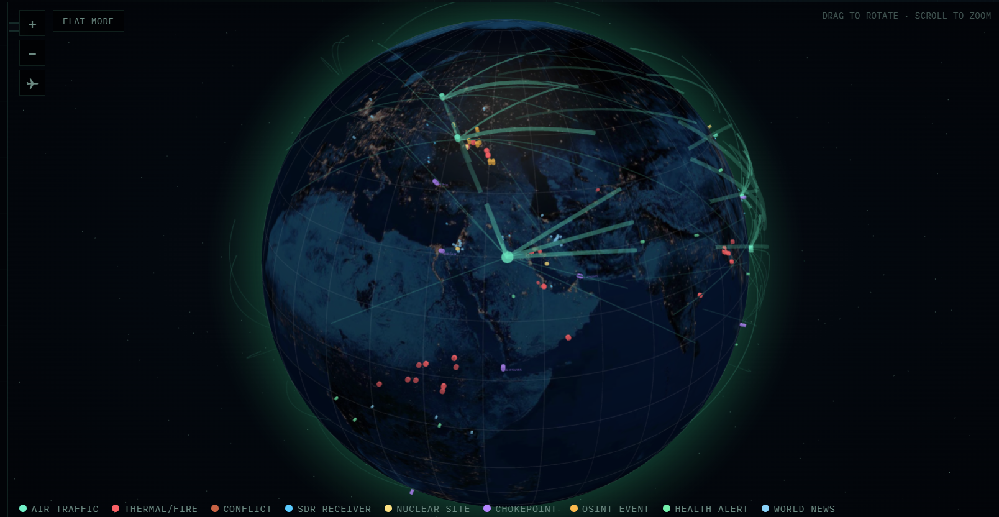

# 🧠 CRUCIX — Open Source Intelligence Terminal

**Full project summary. Updated: November 3, 2026.**
*Maintenance rules: nothing is ever deleted from this document; outdated entries are rewritten as "Before → Now"; every update is dated in the header and logged in the Changelog at the end of the file.*


---

## 📖 Table of Contents
1. [Overview](#-overview)
2. [Screenshots](#-screenshots)
3. [Quick start](#-quick-start)
4. [What you get](#-what-you-get)
5. [🗺️ The Five Maps of Crucix — five dimensions of reality](#️-the-five-maps-of-crucix--five-dimensions-of-reality)
6. [📊 Analytics platform](#-analytics-platform)
7. [🏗️ Infrastructure analyzer](#️-infrastructure-analyzer)
8. [🔀 Router v3.1 — the A+B mechanism](#-router-v31--the-ab-mechanism)
9. [🧪 AI lab](#-ai-lab)
10. [🔑 API keys](#-api-keys)
11. [🏛️ Architecture](#️-architecture)
12. [🧩 Modular server architecture](#-modular-server-architecture)
13. [🧭 Polarity system and narrative reconciliation](#-polarity-system-and-narrative-reconciliation)
14. [Data sources](#-data-sources)
15. [📰 RSS system — the full pipeline](#-rss-system--the-full-pipeline)
16. [🧺 The Basket — the crucix.basket.v1 contract](#-the-basket--the-crucixbasketv1-contract)
17. [📁 config/](#-config)
18. [npm scripts](#-npm-scripts)
19. [Configuration](#-configuration)
20. [API endpoints](#-api-endpoints)
21. [Troubleshooting](#-troubleshooting)
22. [Extensions](#-extensions)
23. [💬 AI chat](#-ai-chat)
24. [🤝 Contributing](#-contributing)
25. [🧠 Predictive core](#-predictive-core)
26. [📰 SmartScroll — RSS and Telegram integration](#-smartscroll--rss-and-telegram-integration)
27. [📜 README changelog](#-readme-changelog)
28. [License](#-license)

## 🚀 Overview

**Crucix** is a platform for collecting, analyzing and visualizing open-source data. It is designed for real-time monitoring of the geopolitical, economic, military and environmental situation.

The architecture follows the **"Basket → AI → Map"** principle:

- **Collection** — data arrives from 226 sources into the basket (`data/basket/`)
- **Analysis** — 68 analyzers compute indices, composites and forecasts (`data/analytics/`); *before: 59 — the count has grown with the RSS analyzer family*
- **AI** — the LLM backend (Mistral by default, with support for local OpenAI-compatible LLMs such as Ollama and LM Studio) generates briefs and forecasts; *before: local LLM via Ollama only*
- **Map** — the result is visualized in **5 autonomous maps**, each displaying its own class of data

### Key features

- ✅ **226 OSINT sources** — satellites, aviation, conflicts, economy, ecology
- ✅ **68 analyzers** — indices, detectors, forecasts, composites (*before: 59*)
- ✅ **655 API modules** — all endpoints serve data from the basket (*before: 370+*)
- ✅ **8 analytics categories** — index, detector, forecast, semantic, flow, market, specialist, space
- ✅ **5 autonomous maps** — Event, Metrics, Semantic, Forecast, Network — each with its own layers, palettes and visualization models
- ✅ **222 layers in total** — 84 + 75 + 35 + 16 + 12, distributed across 5 maps by the channel-separability principle
- ✅ **Infrastructure analyzer** — 114 objects, 15 endpoints
- ✅ **Auto-refresh** every 15 minutes via SSE
- ✅ **Telegram + Discord bots** with two-way control
- ✅ **AI analytics** — Mistral cloud by default; local models (Ollama, LM Studio) supported out of the box (*before: Ollama only*)
- ✅ **Modular architecture** — easy to extend
- ✅ **Zero cloud, zero telemetry, zero subscriptions**

> **Live website:** [https://www.crucix.live/](https://www.crucix.live/)

---

## 📸 Screenshots

| | |
|-|-|
|||
|**Main dashboard**|**Boot animation**|

| | |
|-|-|
|||
|**Map with markers**|**3D WebGL globe**|

---

## ⚡ Quick start

### Local run

```bash
# 1. Clone the repository
git clone https://github.com/fedorfedorov90fd-commits/Crucix.git
cd Crucix
# (This is an actively developed fork. Upstream: https://github.com/calesthio/Crucix)

# 2. Install dependencies (Express only)
npm install

# 3. Copy the .env template and add API keys
cp .env.example .env

# 4. Start the dashboard
npm run dev
```

The dashboard opens at `http://localhost:3117`
*(check the actual port value — it may be configurable via `.env`)*

If `npm run dev` does not work, run directly:

```bash
node --trace-warnings server.mjs
```

### Docker — Before → Now

**Before:** the project shipped with Docker Compose files and a `docker-ready` badge.

**Now:** the Docker files were removed (commit `37af83c`) — the project runs on Node.js **without containerization**. To run, use the local instructions above. There is no container mode in the current version.

---

## 🎯 What you get

### Dashboard

- **3D WebGL globe** (Globe.gl) with atmosphere and star field
- **2D map** (D3) with 9 marker types
- **5 autonomous maps** — each with its own visualization model, independent layers and local reference data
- **Animated arcs** of flights between aviation hubs
- **Region filters** (World, Americas, Europe, Middle East, Asia, Africa)
- **Real-time market data** (indices, crypto, energy, metals)

### Analytics

- **68 analyzers** — from basic indices to composite risk scores (*before: 59*)
- **197 countries** in the characteristics reference
- **147 countries** with a real Gini coefficient
- **194 countries** with World Bank macroeconomics
- **114 objects** of critical infrastructure (25 military bases, 20 nuclear plants, 26 ports, 15 chokepoints, 15 dams, 13 power grids)
- **8 categories** of analytics in `data/analytics/`

### AI capabilities

- **LLM backend** — Mistral by default (`mistral-small-latest`); OpenAI-compatible local LLMs (Ollama, LM Studio) supported
- **AI briefs** (daily, alert, summary)
- **AI-powered forecasts**
- **Semantic search** over news (TF-IDF + cosine similarity)
- **Entity extraction** (NER) from texts

### Integrations

- **Telegram bot** (two-way)
- **Discord bot** (two-way)
- **MCP Server** (Model Context Protocol) — access Crucix from external AI clients
- **CLI analytics** — query analyzers from the terminal

---

## 🗺️ The Five Maps of Crucix — five dimensions of reality

### Why five, not one

Data visualization is the translation of information into visual signals the brain can process. Each data type requires its own "language": events call for points on a map, numeric indicators call for area fills, relationships call for a graph with edges. When different data types are mixed on a single canvas, the brain fails — the signals interfere like two radio channels on one frequency.

This is not an organizational convenience but a consequence of the **theory of perceptual channels** (Munzner, *Visualization Analysis & Design*, 2014, Table 5.3). Human vision has a limited set of channels: position, color, size, shape, transparency. Each channel has a different "bandwidth" — the ability to accurately convey quantitative or categorical values. When two data types claim the same channel at once, **cognitive interference** occurs: the observer cannot separate one signal from another.

The **channel separability principle** (Munzner 2014) states: two visual channels are separable if they can be perceived simultaneously without mutual interference. The five data classes in Crucix use five different channel combinations:

| Map | Visual channels | Data type | vizType |
|-----|----------------|-----------|---------|
| **Event Map** | Position + Hue + Shape | Point events | `marker` |
| **Metrics Map** | Position + Color intensity | Country-level numeric indicators | `choropleth` / `series` |
| **Semantic Map** | Position + Hue (categorical) + Shape | Sentiment and narratives | `choropleth` (diverging) |
| **Forecast Map** | Position + Color intensity + Transparency | Probabilities with confidence | `probability` |
| **Network Map** | Position (force) + Shape + Edge width | Links and relations | `graph` (SVG) |

If all five lived on a single map, four of the five encodings would have to be either disabled or overlaid on each other — and the value of each would drop to zero.

**In plain words:** imagine a world map where terrorist attacks are marked with red dots, countries are colored by inflation level, trade-flow arrows are overlaid on top, and transparency shows recession probability. You cannot make sense of it — the eye cannot read four different "languages" at once. That is why each language gets its own map.

### The autonomy principle

Each of the five maps is **fully autonomous**. This is implemented through the **Bulkhead** pattern (Nygard, *Release It!*, 2007): if one map goes down, the other four keep working. Autonomy is guaranteed by six rules (R1–R6):

- **R1:** No `<script>`, `<link>` or `fetch` reaches outside its own folder. Check: `grep -rn '\.\./' index.html js/*.js` returns 0 lines.
- **R2:** Geographic boundaries (`world.geojson`) live locally in the `data/` folder of each map.
- **R3:** Each map's `layers.js` contains only its own layers — zero foreign ones.
- **R4:** Configuration (`maps-config.js`, `presets.json`) is map-specific.
- **R5:** Each map's `manifest.json` records `local_cross_map: 0`, `failure_domain: 1`.
- **R6:** A failure in one map does not affect the other four.

Each map lives in its own folder: `/dashboard/public/<map-name>/` with its own `index.html`, `js/`, `css/`, `data/`, `presets/`. No shared scripts, no shared styles, no shared data — only a shared server.

---

### 1. Event Map — the Map of Events

**Location:** `/dashboard/public/event-map/`
**URL:** `http://localhost:3117/event-map/`
**Layers:** 84 in 12 categories

Event Map is a world map where specific events are shown as point markers: protests, military incidents, cyberattacks, diplomatic meetings, disasters, migration waves, disease outbreaks. Each dot is one event with coordinates, time, category and priority.

**Data model:** one marker = one event. Thousands of markers on the map, grouped into 84 layers across 12 categories (conflicts, protests, disasters, cyber, politics, diplomacy, economy, terrorism, migration, health, infrastructure, social). Markers cluster on zoom, are colored by category, and open a detail popup on click.

**Visual channel:** Position + Hue + Shape. Position on the map = geographic coordinates of the event. Color = category. Shape = type (circle, triangle, square).

**How it differs from Metrics Map:** Event Map shows individual events (a rally on March 15 in Tbilisi), Metrics Map shows aggregated country indicators (Georgia's unemployment rate = 14%). An event does not reduce to a number, and a number does not reduce to an event — these are different ontologies.

**How it differs from Network Map:** Event Map shows points on a geographic map. Network Map shows links between nodes in an abstract graph space — there are no latitudes or longitudes there.

**Folder:**
```
event-map/
├── index.html
├── manifest.json
├── EVENT-MAP-MANIFEST.md
├── ARCHITECTURE.md
├── AUTONOMY-CHARTER.md
├── css/event-map.css
├── js/
│   ├── core.js
│   ├── countries.js
│   ├── layers.js          ← 84 layers, 12 categories
│   ├── maps-config.js
│   ├── map-controls.js
│   ├── markers.js          ← marker generation and clustering
│   ├── event-map.js
│   ├── copy-data.js
│   ├── heat-timeline.js
│   ├── ssi.js
│   ├── refresh.js
│   ├── cii.js
│   ├── logger.js
│   └── init.js
├── data/world.geojson
└── presets/presets.json
```

**Markers and clustering:**
- Up to 1000+ markers per layer, with a deterministic geo-jitter by seed.
- Clustering: Leaflet.markercluster with adaptive zoom.
- Prioritization: 5 levels (critical → low), affecting size and z-index.
- Popup: category, description, source, time, coordinates.

**Autonomous fallback:**
When the API is unavailable, data is generated locally: 2 markers per country × 90 countries = 180 markers per layer. Position = country coordinates + deterministic jitter. Category and priority — by layer seed.

---

### 2. Metrics Map — the Map of Quantitative Indicators

**Location:** `/dashboard/public/metrics-map/`
**URL:** `http://localhost:3117/metrics-map/`
**Layers:** 75 in 13 categories

Metrics Map is a choropleth world map where each country is filled with a color whose intensity corresponds to the value of a numeric indicator. Inflation, GDP, unemployment, debt/GDP, dollar index, spreads, yield curve, uranium, cyber threats, ESG metrics, HDI, defense spending — 75 indicators in 13 categories.

**Data model:** one country = one indicator value. 90 countries on the map, the value is classified by the Jenks DP method (or Quantile / Equal Interval / Standard Dev / Manual — per domain), then a ColorBrewer palette (sequential or diverging) is applied. The result is country fills with a legend showing class thresholds, classification method and quality (GVF).

**Visual channel:** Position + Color intensity. Position = the country's territory. Color intensity = the indicator value. These two channels are fully separable (Munzner 2014) — position conveys "where", color conveys "how much".

**How it differs from Semantic Map:** Metrics Map shows quantitative values (inflation = 7.2%). Semantic Map shows categorical sentiment (mood = "negative", "neutral", "positive"). Numbers and categories are different data types and need different palettes: sequential (for numbers) and diverging (for categories with a neutral midpoint).

**How it differs from Forecast Map:** Metrics Map displays current, observed values. Forecast Map displays probabilities of future events with an extra channel — transparency encoding model confidence. A current value and the probability of a future event are different semantic entities.

**Folder:**
```
metrics-map/
├── index.html
├── manifest.json
├── METRICS-MAP-MANIFEST.md
├── ARCHITECTURE.md
├── AUTONOMY-CHARTER.md
├── css/metrics-map.css
├── js/
│   ├── core.js
│   ├── countries.js        ← 90 countries with coordinates and statuses
│   ├── layers.js           ← 75 layers, 13 categories
│   ├── maps-config.js      ← classification methods, palettes, breaks
│   ├── series-adapter.js    ← series → choropleth (14 modules, spatial proxies)
│   ├── map-controls.js     ← Leaflet init, Jenks DP, ColorBrewer, GVF, legend
│   ├── markers.js          ← 6 marker layers × 180 = 1080 markers
│   ├── metrics-map.js      ← decision tree: choropleth / series / marker
│   ├── copy-data.js        ← ~500 KB snapshot
│   ├── heat-timeline.js
│   ├── ssi.js              ← Strategic Stress Index
│   ├── refresh.js
│   ├── cii.js              ← Country Instability Index (fallback)
│   ├── logger.js
│   └── init.js
├── data/world.geojson      ← local copy of boundaries (252 KB)
└── presets/presets.json    ← 5 presets with unique keys
```

**Classification methods (Jenks 1963, Brewer 2005):**

| Method | Formula | Use |
|--------|---------|-----|
| Jenks DP | minimizes SDCM, \(O(k \cdot n^2)\) | Default |
| Quantile | equal groups | With outliers |
| Equal Interval | \((max - min) / k\) | Smooth scales |
| Standard Dev | \(\mu \pm 0.5\sigma\), \(\pm 1.5\sigma\) | Normal distribution |
| Manual | expert thresholds | ISM 50, recession 20/40/60/80 |

Quality control: \(GVF = (SDAM - SDCM) / SDAM > 0.7\). Typical values in Metrics Map: 0.90–0.93.

**ColorBrewer palettes:**
- Sequential (7): Blues, YlOrRd, Greens, Oranges, Purples, BuPu, OrRd
- Diverging (4): RdYlGn5, RdBu5, BrBG5, PiYG5

Domain rules: PMI → diverging RdYlGn5 with manual breaks [42, 47, 53, 58] (ISM 50 = boundary). Recession → sequential YlOrRd5 with manual breaks [20, 40, 60, 80]. Copper/Gold → diverging RdBu5, Jenks. Yield Curve → diverging RdBu5, Jenks (inversion = red).

**Layer types:**
- **Choropleth (56):** country fills by indicator value. API → fallback (deterministic seed by `layer.id`, base(status) + noise).
- **Series (14):** market series → choropleth via `SeriesAdapter` with spatial proxies (us_market, oil_producers, financial_centers...). 6 transformations: weighted_value, stress_indicator, ratio_indicator and others.
- **Marker (6):** point markers on a choropleth map (180 markers/layer, 1080 when fully activated).

**Autonomous fallback:**
When the API is unavailable, data is generated locally from `countries.js`: deterministic seed by `layer.id`, for each of the 90 countries value = base(status) + noise(seed), Jenks classification, `applyChoropleth()`, GVF logging.

---

### 3. Semantic Map — the Map of Semantic Analysis

**Location:** `/dashboard/public/semantic-map/`
**URL:** `http://localhost:3117/semantic-map/`
**Layers:** 35 in 12 categories

Semantic Map is a world map where countries are filled by text sentiment: negative, neutral, positive. Sentiment is computed from news and social media streams for each region. Additionally: narratives, disinformation, media tone, propaganda, information warfare, cognitive biases, manipulation, toxicity.

**Data model:** one country = a categorical sentiment class (5 classes per Cowan 2001: very_negative, negative, neutral, positive, very_positive). 35 layers in 12 categories (sentiment, narratives, disinformation, media tone, propaganda, info warfare, social media, topics, credibility, cognitive biases, manipulation, toxicity).

**Visual channel:** Position + Hue (categorical) + Shape. Palette — diverging RdYlGn5 (red → yellow → green) where the middle = neutral sentiment and the edges are extreme values. For narrative clusters — categorical Set1. Marker shape (Circle, Square, Triangle, Diamond) — for categorical differentiation of layers.

**How it differs from Metrics Map:** Metrics Map classifies values by intensity (sequential: "the bigger, the darker"). Semantic Map classifies by category with a neutral center (diverging: "bad — neutral — good"). These are different palettes because the number 7.2 (inflation) has no "neutral" value, while "neutral" sentiment is a zero point on the scale.

**How it differs from Event Map:** Event Map shows individual events as points. Semantic Map shows aggregated sentiment of the information field per country as fills. An event is "what happened". Sentiment is "how it is being reported".

**Folder:**
```
semantic-map/
├── index.html
├── manifest.json
├── SEMANTIC-MAP-MANIFEST.md
├── ARCHITECTURE.md
├── AUTONOMY-CHARTER.md
├── css/semantic-map.css
├── js/
│   ├── core.js
│   ├── countries.js
│   ├── layers.js           ← 35 layers, 12 categories
│   ├── maps-config.js      ← diverging RdYlGn5, Set1 for clusters
│   ├── sentiment-adapter.js ← 5 sentiment classes (Cowan 2001)
│   ├── map-controls.js     ← Leaflet, diverging choropleth, legend
│   ├── markers.js          ← markers by type (Circle, Square, Triangle, Diamond)
│   ├── semantic-map.js     ← decision tree
│   ├── copy-data.js
│   ├── heat-timeline.js
│   ├── ssi.js
│   ├── refresh.js
│   ├── cii.js
│   ├── logger.js
│   └── init.js
├── data/world.geojson
└── presets/presets.json
```

**Sentiment adapter:**
5 classes per Cowan 2001: very_negative (0–20%), negative (20–40%), neutral (40–60%), positive (60–80%), very_positive (80–100%). Diverging palette RdYlGn5: red → orange → yellow → light green → green. The neutral class is yellow, at the center of the scale.

**Autonomous fallback:**
When the API is unavailable, sentiment is generated from `countries.js`: seed by `layer.id` + `country.status`, 5 classes with a weighted distribution (neutral dominates ~40%), diverging fills, logging.

---

### 4. Forecast Map — the Map of Probabilistic Forecasts

**Location:** `/dashboard/public/forecast-map/`
**URL:** `http://localhost:3117/forecast-map/`
**Layers:** 16, all of type `probability`

Forecast Map is a world map where countries are filled by the probability of an event: recession, conflict escalation, political crisis, food crisis. Each forecast carries **double encoding**: color = probability class, transparency = model confidence.

**Data model:** one country = probability (0–100%) + model confidence (0–1). 16 layers, all of type `probability`. Forecast horizon — from 1 month to 1 year.

**Visual channel:** Position + Color intensity + Transparency. This is a **three-channel encoding** — the only one in Crucix that uses transparency as an information channel rather than decoration. Color (sequential YlOrRd5, manual breaks [20, 40, 60, 80]) conveys the probability class. Transparency (`opacity = 0.4 + 0.5 × confidence`, Cressie 1993, *Statistics for Spatial Data*) conveys model confidence: the more transparent the fill, the less confidence in the forecast.

**In plain words:** if the recession forecast for country X is 75% and the model is 90% confident, you will see a bright red fill. If the same 75% probability but only 40% confidence, the fill will be pale red. The eye immediately reads: "high probability, but low confidence — the forecast is unreliable." A regular choropleth map carries none of this information.

**How it differs from Metrics Map:** Metrics Map shows observed facts: inflation = 7.2%. Forecast Map shows probabilities of future events with uncertainty metadata. Fact and forecast are different epistemological entities. A fact has no "confidence" (it has already happened). A forecast without stated confidence is not a forecast but a guess.

**How it differs from Semantic Map:** Semantic Map uses a diverging palette (two-sided: bad ↔ good). Forecast Map uses a sequential palette (one-sided: 0% → 100%) with an extra transparency channel. A two-sided palette does not suit probabilities because "0% probability" is not "the opposite of 100%" but simply the lower bound of the scale.

**Folder:**
```
forecast-map/
├── index.html
├── manifest.json
├── FORECAST-MAP-MANIFEST.md
├── ARCHITECTURE.md
├── AUTONOMY-CHARTER.md
├── css/forecast-map.css
├── js/
│   ├── core.js
│   ├── countries.js
│   ├── layers.js           ← 16 layers, all of type probability
│   ├── maps-config.js      ← manual breaks [20,40,60,80], YlOrRd5, opacity formula
│   ├── forecast-adapter.js ← spatial proxies for 4 forecast sources
│   ├── map-controls.js     ← Leaflet, double encoding (color + opacity), legend
│   ├── markers.js
│   ├── forecast-map.js     ← decision tree
│   ├── copy-data.js
│   ├── heat-timeline.js
│   ├── ssi.js
│   ├── refresh.js
│   ├── cii.js
│   ├── logger.js
│   └── init.js
├── data/world.geojson
└── presets/presets.json
```

**Double encoding (Cressie 1993):**
Color: sequential YlOrRd5, manual breaks [20, 40, 60, 80] → 5 probability classes (very_low, low, medium, high, very_high). Transparency: `opacity = 0.4 + 0.5 × confidence`, where confidence ∈ [0, 1]. At confidence = 1.0 → opacity = 0.9 (bright fill). At confidence = 0.0 → opacity = 0.4 (pale fill). Visibility threshold: at opacity < 0.4 the fill is not drawn.

**Spatial proxies for forecast sources:**
4 sources: market_prediction (prediction_markets), model_forecast (Bayesian models), ai_forecast (LLM agents), composite (ensemble). Each source is mapped to countries via spatial proxies (us_market, eu_zone, emerging_markets, global_all).

**Autonomous fallback:**
When the API is unavailable, data is generated locally: probability = base(status) + noise(seed), confidence = 0.5 + noise(seed) × 0.3, classification by manual breaks, double fill (color + transparency), logging.

---

**Location:** `/dashboard/public/network-map/`
**URL:** `http://localhost:3117/network-map/`
**Layers:** 12, type `graph` (SVG force-directed)

Network Map is not a geographic map. It is a **graph of relationships**, visualized through force-directed simulation in SVG. Nodes are countries, organizations, financial flows, cyber networks. Edges are trade links, sanctions relations, migration flows, financial channels. There are no latitudes or longitudes here; node position is computed by a physical simulation.

**Data model:** nodes (entities) + edges (relations). 12 layers across categories (cyber networks, trade, finance, migration, diplomacy, energy). Nodes have a type (Circle, Square, Triangle, Diamond) and a size (proportional to Degree centrality). Edges have a width (proportional to the link weight) and a color (relation type).

**Visual channel:** Position (force) + Shape + Edge width. Position is not geographic but topological: it is computed by force simulation (Coulomb repulsion between nodes, Hooke attraction along edges, Verlet integration). Node shape — categorical type (Circle = country, Square = organization, Triangle = financial center, Diamond = cyber node). Edge width — link weight.

**Why Network Map does not use Leaflet or world.geojson:**
A geographic map (Leaflet + GeoJSON) encodes position through latitude and longitude. But for a relationship graph, geographic position is not the point; the point is topology (who is connected to whom, who is central, who is peripheral). A force-directed layout places connected nodes close and unconnected ones far apart, regardless of their real position on Earth. If we used Leaflet, nodes would be stuck in their geographic coordinates and the link structure would become unreadable.

**In plain words:** if Event Map is a world map with dots and Metrics Map is a world map with fills, Network Map is a "web map" where relationships matter more than location. You see who is connected to whom, who is at the center, who is on the periphery, and which nodes carry the most paths. That cannot be shown on a regular map.

**How it differs from the other four maps:**
Network Map is the only map without Leaflet and without `world.geojson`. Instead of raster rendering — an SVG force-directed graph. Instead of geographic coordinates — topological simulation. Instead of choropleth or marker — edges and nodes. The dossier panel shows graph metrics (Degree, Betweenness, PageRank) instead of country indicators.

**Folder:**
```
network-map/
├── index.html
├── manifest.json
├── NETWORK-MAP-MANIFEST.md
├── ARCHITECTURE.md
├── AUTONOMY-CHARTER.md
├── css/network-map.css
├── js/
│   ├── core.js
│   ├── countries.js        ← node reference (countries, organizations)
│   ├── layers.js           ← 12 graph layers
│   ├── network-config.js  ← force simulation parameters (alpha, charge, link distance)
│   ├── graph-engine.js    ← force simulation: Coulomb repulsion, Hooke attraction, Verlet
│   ├── graph-renderer.js   ← SVG rendering: nodes, edges, labels
│   ├── graph-panel.js      ← dossier panel: Degree, Betweenness, PageRank
│   ├── network-map.js      ← decision tree
│   ├── copy-data.js
│   ├── refresh.js
│   ├── logger.js
│   └── init.js
├── data/
│   └── nodes.json          ← node reference (no world.geojson)
└── presets/presets.json
```

**Force simulation (Barabási 2016, *Network Science*):**
- **Repulsion:** Coulomb repulsion, `F = k² / d` (Fruchterman-Reingold 1991), where k is the ideal link length, d is the distance.
- **Attraction:** Hooke attraction along edges, `F = d² / k`.
- **Integration:** Verlet (velocity-free), `x_new = 2·x − x_prev + a·dt²`.
- **Cooling:** alpha decay from 1.0 to 0.001 over 300 iterations.
- **Stabilization:** the simulation stops at alpha < 0.005.

**4 node shapes:**
- Circle — country (90 nodes)
- Square — international organization
- Triangle — financial center
- Diamond — cyber node

**Graph metrics (dossier panel):**
- **Degree centrality** — the number of a node's direct links.
- **Betweenness centrality** — the share of shortest paths passing through the node (Freeman 1977).
- **PageRank** — an iterative importance metric (Page et al. 1999), damping = 0.85.

**Autonomous fallback:**
When the API is unavailable, the graph is generated locally: seed by `layer.id`, 30–60 nodes from the reference, edges by weighted random (preferential attachment, Barabási-Albert), force simulation runs on the client.

---

### Summary table of the five maps

| Parameter | Event Map | Metrics Map | Semantic Map | Forecast Map | Network Map |
|-----------|-----------|-------------|--------------|--------------|-------------|
| **Folder** | `event-map/` | `metrics-map/` | `semantic-map/` | `forecast-map/` | `network-map/` |
| **Layers** | 84 | 75 | 35 | 16 | 12 |
| **Categories** | 12 | 13 | 12 | 1 | 6 |
| **vizType** | `marker` | `choropleth` / `series` | `choropleth` (diverging) | `probability` | `graph` (SVG) |
| **Channels** | Position + Hue + Shape | Position + Color intensity | Position + Hue (cat.) + Shape | Position + Color + Transparency | Position (force) + Shape + Edge |
| **Palette** | categorical | sequential + diverging | diverging RdYlGn5, Set1 | sequential YlOrRd5 + opacity | categorical (node shapes) |
| **Map** | Leaflet + GeoJSON | Leaflet + GeoJSON | Leaflet + GeoJSON | Leaflet + GeoJSON | SVG (no Leaflet, no GeoJSON) |
| **Data type** | Events (points) | Numbers (country aggregates) | Categories (sentiment) | Probabilities + confidence | Links (graph) |
| **Fallback** | 180 markers/layer | 90 countries, Jenks, GVF | 90 countries, diverging | 90 countries, double encoding | 30–60 nodes, preferential attachment |
| **Failure domain** | 1 | 1 | 1 | 1 | 1 |

### Why the maps cannot live together — the scientific rationale

#### 1. Cognitive channel interference

Human vision can process 2–3 visual channels simultaneously, but only if they are **separable** — that is, they do not compete for the same visual resources (Munzner 2014, §5.3). Position and color intensity are separable. Color intensity and transparency are **not separable**: the brain cannot distinguish "darker because the value is higher" from "darker because the layer is less transparent". That is why Forecast Map uses transparency deliberately — as the only layer encoding uncertainty — and only because probability is the only data type where uncertainty is part of the semantics, not noise.

If we tried to overlay choropleth (Metrics) on top of marker (Event), both encodings would use the map position, and the brain could not separate "where the event is" from "where the country ends". The result is visual noise in which no pattern is legible.

#### 2. Different data models

The five maps are five different **data models**, each with its own ontology:

- **Event** — a point in space-time. Entity: "something happened here and now". Attributes: coordinates, time, category, priority.
- **Indicator** — a number aggregated over a territory. Entity: "a country's metric on a date". Attributes: value, unit, period.
- **Sentiment** — a category computed from texts. Entity: "how it is being reported". Attributes: class (5 levels), source, confidence.
- **Forecast** — the probability of a future event with uncertainty. Entity: "what may happen and how sure we are". Attributes: probability, horizon, confidence.
- **Relation** — a link between entities. Entity: "who is connected to whom". Attributes: nodes, edges, weights, types.

These models do not reduce to one another. An event cannot be "averaged" into an indicator without losing temporal and spatial precision. An indicator cannot be "unclustered" back into events. A forecast cannot be "observed" as a fact. A relation cannot be "painted" as a choropleth. Each model requires its own visual language, and these languages are incompatible.

#### 3. The Separation of Concerns principle (Dijkstra 1974)

Splitting into five maps is also an architectural decision. Each map has its own load DAG, its own set of scripts, its own CSS, its own `manifest.json`, its own `layers.js`. A failure in one map (an error in `layers.js`, a dead API, a broken fallback) does not spread to the rest. This is the Bulkhead pattern (Nygard 2007): isolation of failure domains.

If all layers lived in a single `layers.js` (84 + 75 + 35 + 16 + 12 = 222 layers), a single syntax error in one layer would take down all 222. With five maps, an error in one Event Map layer leaves Metrics, Semantic, Forecast and Network fully operational.

#### 4. An explanation for the layperson

Imagine you work at an airport and need to simultaneously:
1. Track every aircraft on radar (events — Event Map)
2. See each terminal's load in percent (metrics — Metrics Map)
3. Understand how passengers rate the service (sentiment — Semantic Map)
4. Know the probability of tomorrow's flight delays (forecast — Forecast Map)
5. See the airline route diagram (relations — Network Map)

Can this all be drawn on one screen? Technically — yes. But you will understand nothing: aircraft dots will obscure terminal fills, route arrows will cover the radar, and forecast transparency will clash with metric colors. So each type of information gets its own screen. Five screens — not because it is more convenient, but because otherwise the data becomes invisible.

---

## 📊 Analytics platform

Crucix ships with a **full analytics platform** — 68 analyzers grouped into **8 categories** (*before: 59 — the count grew with the RSS analyzer family*).

### Analyzer categories

| Category | Description | Count |
|---|---|---|
| **index** | Indices (country-level, regional) | 2 |
| **detector** | Event and anomaly detectors | 8 |
| **forecast** | Forecast models | 4 |
| **semantic** | Semantic text analysis | 6 |
| **flow** | Flows (trade, migration, resources) | 10 |
| **market** | Market indicators | 7 |
| **specialist** | Specialized (infrastructure, nuclear, sanctions) | 21 |
| **space** | Space | 1 |
| **TOTAL** | | **59** |

*Note: the category distribution reflects the state as of the date this table was composed; the current actual number of analyzers is 68 (the growth came from the RSS family: silence-detector, taxonomy-gaps, source-coordination, narrative-framing, alert-engine and related). For live counts see `/registry`.*

### Key analyzers

**Indices (index):**
- `country-instability` — Country Instability Index (CII). The reference implementation.
- `resilience-index` — Resilience Index (197 countries, 152 unique scores)

**Composites (specialist):**
- `strategic-risk-composite` — Strategic risk (instability + resilience deficit + infrastructure + geopolitics)
- `infrastructure-cascade` — Infrastructure cascade analysis (13 files, 15 endpoints)

**Forecasts (forecast):**
- `conflict-escalation-tracker` — Conflict escalation (6 levels)
- `ai-forecasts` — Forecasts via LLM
- `social-briefing` — Briefs via LLM (daily, alert, summary)
- `central-bank-predictor` — Central bank action forecast

**Detectors (detector):**
- `geo-convergence` — Geographic convergence
- `threat-classification` — Threat classification
- `surge-detection` — Anomaly surges
- `focal-point-detection` — Focal activity points
- `baseline-alerting` — Threshold alerts
- `cyber-attack-monitor` — Cyberattacks
- `snapshot-system` — State snapshots
- `pizza-index` — Headquarters activity (internal index)

**Semantics (semantic):**
- `adaptive-news-clustering` — News clustering (TF-IDF)
- `ai-news-synthesis` — AI news synthesis
- `entity-extraction` — NER
- `multi-source-corroboration` — Fact-checking
- `source-credibility` — Source credibility
- `social-sentiment-analyzer` — Social media sentiment

**Flows (flow):**
- `cross-stream-correlation` — Cross-correlation of data streams
- `route-explorer` — Alternative routes
- `supply-chain-cascade-engine` — Supply chain cascades
- `supply-chain-resilience` — Supply resilience
- `tanker-fleet-monitor` — Tanker fleet (dark ships)
- `arms-transfer-tracker` — Arms transfers
- `diplomatic-tracker` — Diplomatic activity
- `migration-flow-tracker` — Migration flows
- `signal-aggregator` — Signal aggregation
- `risk-signal-aggregator` — Risk aggregation

**Markets (market):**
- `market-composite` — Market composite (VIX, oil, gold, DXY)
- `derived-market-analytics` — Derived metrics (Gold/Oil, Copper/Gold)
- `energy-market-intelligence` — Energy markets
- `prediction-markets` — Prediction markets
- `stablecoin-monitor` — Stablecoins
- `etf-flow-analysis` — ETF flows
- `fx-reserves-monitor` — FX reserves
- `tick-data-analyzer` — Tick data

**Specialists (specialist) — continued:**
- `sanctions-pressure` — Sanctions pressure
- `political-stability-monitor` — Political stability
- `food-security-monitor` — Food security

**Space (space):**
- `satellite-analyzer` — Satellite analysis

### How the analysis works

1. **Collection** — collectors (`scripts/collectors/`) put data into the basket `data/basket/`
2. **Computation** — analyzers (`scripts/analyzers/`) read the basket + reference data, compute indices, write to `data/analytics/{category}/`
3. **Serving** — API modules (`apis/sources/{name}-api.mjs`) read the results and serve them via `/api/layers/{name}`
4. **Display** — a layer on one of the 5 maps (`dashboard/public/<map-name>/js/layers.js`) renders the result

### `data/analytics/` structure

```
data/analytics/
├── _manifest.json     # registry of all analyzers
├── _catalog.json      # catalog of classes
├── _lineage.json      # data lineage
├── _health.json       # status
├── _schema.json       # schema
├── index/             # indices
├── detector/          # detectors
├── forecast/          # forecasts
├── semantic/          # semantics
├── flow/              # flows
├── market/            # markets
├── specialist/        # specialists
└── space/             # space
```

### Running an analyzer

```bash
# One analyzer
node scripts/analyzers/resilience-index.mjs

# All analyzers (manually)
for f in scripts/analyzers/*.mjs; do node "$f"; done

# Full cycle: collection → analysis → serving
node scripts/collectors/collect-worldbank.mjs
node scripts/analyzers/strategic-risk-composite.mjs
curl http://localhost:3117/api/layers/strategic-risk-composite/stats
```

---

## 🏗️ Infrastructure analyzer

**Infrastructure Cascade** is the most complex analyzer in Crucix. It consists of **13 files** and serves **15 endpoints**.

### Files

**Block A (core):**
- `infrastructure-graph-core.mjs` — graph, haversine
- `infrastructure-propagation.mjs` — cascade propagation
- `infrastructure-pagerank-critical.mjs` — PageRank, betweenness
- `infrastructure-temporal.mjs` — temporal decay

**Block B (computation):**
- `infrastructure-vulnerability-calc.mjs` — adaptive vulnerability computation
- `infrastructure-monte-carlo.mjs` — Monte Carlo, sensitivity
- `infrastructure-scenario-engine.mjs` — 8 scenarios (Hormuz, Taiwan, nuclear plants...)

**Block C (monitoring):**
- `infrastructure-military-monitor.mjs` — military bases
- `infrastructure-chokepoint-monitor.mjs` — straits, canals
- `infrastructure-nuclear-monitor.mjs` — nuclear power plants
- `infrastructure-supply-chain.mjs` — HHI concentration
- `infrastructure-cargo-anomaly.mjs` — cargo flow anomalies

**+ `infrastructure-api.mjs`** — the HTTP handler

### Infrastructure objects

`data/infrastructure/objects.json` — **114 objects:**

- 25 military bases (USA, Russia, China, NATO)
- 20 nuclear power plants (Zaporizhzhia, Fukushima, Bushehr, Akkuyu...)
- 26 ports (Shanghai, Singapore, Rotterdam...)
- 15 chokepoints (Hormuz, Suez, Taiwan, Bab el-Mandeb...)
- 15 dams (Three Gorges, Itaipu, Kakhovka...)
- 13 power grids (East China, ERCOT, Ukrenergo...)

### 15 endpoints

```
GET /api/layers/infrastructure-api                    — root
GET /api/layers/infrastructure-api/vulnerability      — vulnerability
GET /api/layers/infrastructure-api/cascade            — cascade
GET /api/layers/infrastructure-api/simulate           — simulation
GET /api/layers/infrastructure-api/critical-paths     — critical paths
GET /api/layers/infrastructure-api/pagerank           — PageRank
GET /api/layers/infrastructure-api/sensitivity        — sensitivity
GET /api/layers/infrastructure-api/featurecollection  — GeoJSON
GET /api/layers/infrastructure-api/stats              — statistics
GET /api/layers/infrastructure-api/military           — military objects
GET /api/layers/infrastructure-api/chokepoints        — chokepoints
GET /api/layers/infrastructure-api/nuclear            — nuclear plants
GET /api/layers/infrastructure-api/supply-chain       — supply chains
GET /api/layers/infrastructure-api/cargo-anomalies    — anomalies
GET /api/layers/infrastructure-api/scenarios          — scenarios
```

### Key results

- **PageRank → chokepoint-taiwan** (the most connected node)
- **Top bottleneck → chokepoint-malacca**
- **Vulnerability max → npp-zaporizhzhia**
- **Sensitivity → exposure** (the most influential factor)
- **Taiwan blockade scenario → 3 nodes affected**
- **Hormuz closure scenario → 5 nodes affected**

---

## 🔀 Router v3.1 — the A+B mechanism

**Router** (`server/router.mjs`) — the key component. It decides which module handles a request.

### 4 lookup mechanisms

**Mechanism A (priority) — `export const route`:**

The API module declares its own prefix:
```javascript
export const route = '/api/layers/infrastructure-api';
export default handleInfrastructureAPI;
```

On module load, Router reads `module.route` and registers it in `modulePrefixCache`. All subsequent requests to `/api/layers/infrastructure-api/*` resolve **in microseconds** from cache.

**routes-api.json — exact match:**

An entry like `{ path: '/api/layers/country-instability', module: 'country-instability-api' }`. Works for legacy modules.

**routes-api.json — wildcard:**

An entry like `{ path: '/api/layers/infrastructure-api/*', module: 'infrastructure-api' }`. Works as a fallback.

**Mechanism B — auto-prefix:**

If a file in `apis/sources/` is named `{name}-api.mjs`, it is automatically available via `/api/layers/{name}/*`. Covers 300+ legacy modules.

### Lookup priority

1. `modulePrefixCache` (Mechanism A) — fastest
2. `routes-api.json (exact)` — exact match
3. `routes-api.json (wildcard)` — honoring `*`
4. `autoPrefixCache` (Mechanism B) — by file name

### Before → Now: the registry-driven evolution

**Before:** `server/router.mjs` carried a hard-coded `LEGACY_ALIASES` object, edited by hand. Modules that renamed or moved silently broke — dozens of routes returned 404 (in one audit, `usgs-api` and 57 other modules), and each fix was a manual edit with a risk of breaking the rest.

**Now:** the legacy map is generated automatically:
- `server/build-registry.mjs` — before start, builds the registry of modules from `apis/sources/`;
- `server/build-legacy-aliases.mjs` — generates `server/legacy-aliases.generated.json` (358 records), which `router.mjs` imports instead of a hard-coded object;
- `server/legacy-stubs.json` — the whitelist of 34 API stubs (no v2, no basket) is kept in a separate file;
- `server/verify.mjs` — a single verifier: it walks all registered routes and pages, and reports the status (200 / stub / 404) for each;
- `scripts/lint-contract.mjs` — checks basket contracts; the server **refuses to start** on a contract violation. This is a feature, not a bug: a broken contract is caught at boot, not in production;
- the `req.url` rewrite fix in LEGACY redirects — the target module now sees the rewritten path, not the original one; this closed the 404s for 58 modules;
- the generator handles dots in file names (fixed for `rsshub.classified`).

### For the developer

**A new API module** — adding `export const route` (Mechanism A) is recommended:

```javascript
// apis/sources/my-module-api.mjs
export const route = '/api/layers/my-module';

export default async function handler(req, res) {
  // ...
}
```

There is **no longer any need** to add an entry to `routes-api.json` manually. The module registers itself.

---

## 🧪 AI lab

The AI lab is the environment where the LLM becomes an active participant of the analysis.

### Components

- **LLM backend** — **Mistral cloud by default** (`mistral-small-latest`); *before: local LLM via Ollama only*
- **OpenAI-compatible local LLMs** — Ollama (`http://localhost:11434`: llama3.1:8b, mistral:7b, phi3:3.8b) and LM Studio; any endpoint speaking the OpenAI protocol works
- **AI Gateway** — `apis/sources/ai-gateway.mjs`
- **RAG module** — `apis/sources/rag-module/`, port 3120
- **AI Chat** — `http://localhost:8080`

### AI lab pipeline

1. **Data collection** → `data/basket/*.json`
2. **Analyzer computation** → `data/analytics/{category}/*.json`
3. **Serving via API** → `GET /api/layers/{name}`
4. **AI forecasting** → `data/analytics/forecast/*.json`
5. **Brief generation** → `daily-briefing.mjs` via the LLM backend
6. **Semantic search** → RAG module on port 3120

### AI modules

- **ai-news-synthesis** — news synthesis via LLM
- **ai-forecasts** — probabilistic forecasting
- **social-briefing** — 3 brief formats (daily, alert, summary)
- **daily-briefing.mjs** — daily digest
- **ai-chat-api** — chat API
- **ai-news-analyzer** — news analysis via LLM
- **ai-news-rating** — news rating
- **ai-processor** — text processing
- **ai-filter** — content filtering
- **llm_agents** — LLM agents
- **agentic_engine** — the agentic engine (planner / executor / narrator / tool_registry)

The division of labor: **numbers are computed by code, text is written by the model.** AI never replaces analyzers — it reads their outputs and turns them into human language.

---

## 🔑 API keys

Crucix **works without API keys** — only open sources are used. Project rule (12.2): no registrations, no keys, no OAuth.

### Open sources (keyless)

- **USGS Earthquakes** — earthquakes
- **NOAA SWPC** — space weather
- **OpenSky Network** — aircraft (anonymous)
- **Open-Meteo** — weather
- **Where the ISS at** — ISS
- **Launch Library 2** — space launches
- **Frankfurter** — ECB exchange rates
- **Hacker News** — top news
- **mledoze/countries** — reference of 257 countries (*before: 250; the reference was expanded to the full ISO 3166-1 set: alpha2/alpha3/numeric, en/ru names, UN regions, aliases*)
- **CISA KEV** — vulnerabilities
- **CoinGecko** — crypto
- **US Treasury** — US debt
- **ECB Data Portal** — EU macro
- **World Bank** — macro for 197 countries
- **GDELT** — news (requires a browser User-Agent, pause ≥5 s)

### If a key is still needed

One key (may be useful): `OLLAMA_HOST` for an external Ollama. That is local — no registration required. Mistral cloud uses a key from `.env` if configured.

---

## 🏛️ Architecture

### The "Basket → AI → Map" principle

```
External API
    ↓
Collector (scripts/collectors/collect-*.mjs)
    ↓
Basket (data/basket/*.json)
    ↓
Analyzer (scripts/analyzers/*.mjs)
    ↓
Analytics (data/analytics/{category}/*.json)
    ↓
API module (apis/sources/*-api.mjs)
    ↓
Map (dashboard/public/<map-name>/)
```

### The key rule

**No module makes fetch calls to external APIs.** All data comes only from the basket. The only exception is collectors, which fill the basket.

### Project structure

```
Crucix/
├── apis/sources/            # 655 API modules (before: 370+)
├── scripts/
│   ├── collectors/          # collectors into the basket
│   └── analyzers/           # analyzers
├── data/
│   ├── basket/              # data files, crucix.basket.v1 contract
│   ├── analytics/           # 8 analytics categories
│   ├── infrastructure/      # 114 objects
│   ├── reference/           # references (197 countries, Gini)
│   ├── feeds/               # feed lists: urls-classified, urls-direct, urls-tor, urls-dead, topics
│   └── geo/                 # world.geojson, country-coords
├── config/                  # project config: taxonomy.json, smartscroll.json, reference/
├── server/                  # server modules
│   ├── server.mjs           # entry point
│   ├── router.mjs           # router v3.1
│   ├── build-registry.mjs   # registry builder (runs before start)
│   ├── build-legacy-aliases.mjs  # legacy alias generator
│   ├── legacy-aliases.generated.json
│   ├── legacy-stubs.json    # whitelist of 34 stubs
│   ├── verify.mjs           # route verifier
│   ├── loader.mjs           # module loader
│   ├── modules.json         # 655 modules
│   ├── routes-api.json      # legacy routes
│   └── pages.mjs            # page routes
├── dashboard/public/        # pages and 5 maps
│   ├── event-map/           # 84 layers, markers
│   ├── metrics-map/         # 75 layers, choropleth
│   ├── semantic-map/        # 35 layers, sentiment
│   ├── forecast-map/        # 16 layers, probability
│   └── network-map/         # 12 layers, SVG graph
├── docs/help/               # reference docs ru/en (582 ru + 566 en)
├── ai-memory-sync/          # AI memory files
└── logs/collectors/         # collector logs
```

---

## 🧩 Modular server architecture

All server files live in `server/`:

- `server.mjs` — entry point (30 lines)
- `router.mjs` — API router (Mechanism A+B)
- `build-registry.mjs` — module registry builder (runs before server start)
- `build-legacy-aliases.mjs` — LEGACY_ALIASES generator
- `legacy-aliases.generated.json` — generated legacy map (imported by router.mjs)
- `legacy-stubs.json` — whitelist of API stubs (34)
- `verify.mjs` — single verifier for all routes and pages
- `loader.mjs` — module loader from `modules.json`
- `api.mjs` — API routes (registry and others)
- `pages.mjs` — page routes
- `utils.mjs` — utilities (`sendJSON`, `sendError`)
- `config.mjs` — port, MIME types
- `static.mjs` — static file serving
- `modules.json` — API module registry (655)
- `routes-api.json` — API routes (legacy)
- `pages.json` — page registry
- `routes-pages.json` — page routes

---

## 🧭 Polarity system and narrative reconciliation


**Version:** 1.0 · **Added:** 22–23.09.2026

### What it is

A system that **computes geopolitical polarity from data** and **reconciles Russian and Western narratives on a given topic**. Not propaganda — comparative framing analysis on observable data.

**Key principle:** the pole is **computed**, not set by a list. If the data changes — the pole changes automatically.

### Components

| File | Type | Purpose |
|------|------|---------|
| `apis/sources/pole-tracker-api.mjs` | API | Computes country polarity from 8 basket indicators |
| `apis/sources/narrative-splitter-api.mjs` | API | Reconciles Russian and Western narratives by topic |
| `apis/sources/source-camps.json` | Config | Mapping of sources and baseline countries to poles |
| `dashboard/public/pole-map.html` | Page | Pole map: countries, confidence, vectors |
| `dashboard/public/narrative-arena.html` | Page | Narrative reconciliation: Russia / West / Divergences |
| `scripts/snapshot-rsshub.mjs` | Script | News history accumulation (systemd timer) |

### Pages

- **🌐 Pole Map** — [http://localhost:3117/pole-map](http://localhost:3117/pole-map)
  Shows three poles (russian / western / non_aligned) with countries, the polarity index, vectors (sanctions, info warfare, military presence), basket status.

- **⚡ Reconcile narratives** — [http://localhost:3117/narrative-arena](http://localhost:3117/narrative-arena)
  Three columns: Russian narrative / Western narrative / divergences. Presets: sanctions, Ukraine, energy transition, conflict, gas.

### API endpoints

```bash
# All poles
curl http://localhost:3117/api/layers/pole-tracker

# One country in detail
curl "http://localhost:3117/api/layers/pole-tracker?country=russia"

# Narrative reconciliation by topic
curl -G http://localhost:3117/api/layers/narrative-splitter \
    --data-urlencode "topic=Ukraine" \
    --data-urlencode "limit=10"

# Detailed output
curl "http://localhost:3117/api/layers/narrative-splitter?topic=sanctions&detail=true"
```

### What the terms mean

| Term | Meaning |
|------|---------|
| **silence** | One side writes (N>0), the other is silent (0). The strongest suppression signal |
| **framing_gap** | Both sides write, but with different framing |
| **double_standard** | Coverage imbalance >3x in one direction |
| **polarity_index** | 0..1: 0 = unipolar world, 1 = maximum polarity |
| **confidence** | 0..0.98: confidence in the country classification |
| **basis** | Classification source: `baseline_plus_data` / `data_driven` / `weak_signals` / `no_data` |

### History accumulation

The script `scripts/snapshot-rsshub.mjs` runs on a **systemd timer every hour at minute 02**:

- Updates `data/basket/rsshub.json` via `collect-rsshub.mjs`
- Copies the snapshot to `data/analytics/rss-history/rsshub-<timestamp>.json`
- Maintains the `index.json` index
- Trims the archive to 168 snapshots (7 days)

```bash
# Timer control
systemctl --user status crucix-rsshub-snapshot.timer
systemctl --user list-timers crucix-rsshub-snapshot.timer
tail -20 logs/rss-history/systemd.log

# Manual run
node scripts/snapshot-rsshub.mjs
```

**Why:** after a week, 84,000 items accumulate — enough for real co-occurrence analysis of topics (threat inflation, selective framing).

### Reference docs

Full reference for each page and module:
- `data/help/ru/pole-tracker-api.txt` — polarity module API
- `data/help/ru/narrative-splitter-api.txt` — reconciliation module API
- `data/help/ru/pole-map.txt` — pole map page
- `data/help/ru/narrative-arena.txt` — narrative reconciliation page
- `data/help/ru/CRUCIX_POLARITY_OVERVIEW.txt` — system overview

---

## Data sources

### References
- `data/reference/country-characteristics.json` — **197 countries**
- `data/reference/gini-index.json` — **147 countries with Gini**
- `data/reference/country-aliases.json` — 152 aliases
- `data/reference/rest-countries.json` — 257 countries (mledoze) (*before: 250; expanded to the full ISO 3166-1 set*)

### Technology and cybersecurity
- `cisa-kev.json` — known vulnerabilities
- `cve.json` — CVEs
- `botnets.json` — botnets
- `ransomware.json` — ransomware

### Other
- `hackernews-top.json` — HN
- `cables_24.json` — submarine cables
- `pipelines_24.json` — pipelines
- `datacenters.json` — data centers

---

## 📜 npm scripts

```bash
npm run dev              # start the server (port 3117)
npm run collect          # run all collectors
npm run analyze          # run all analyzers
npm run daily-briefing   # generate the daily brief
npm run registry         # generate the registry
```

Test suites (from package.json):

```bash
npm run test             # page check (scripts/check-pages.mjs)
npm run test:unit        # unit tests of the predict core
npm run test:property    # property-based tests
npm run test:fuzz        # fuzz tests
npm run test:integration # integration tests
npm run test:mutation    # mutation tests
npm run test:all         # all modules + mutation tests
npm run test:all-modules # all predict modules
npm run test:mutation:meta        # mutation: meta_learner
npm run test:mutation:hypergraph  # mutation: hypergraph
npm run test:mutation:attention   # mutation: attention
npm run test:mutation:coevolution # mutation: coevolution
```

---

## ⚙️ Configuration

### Environment variables

Copy `.env.example` to `.env`. Key variables:

- `PORT` — server port (default 3117)
- `OLLAMA_HOST` — Ollama URL (default `http://localhost:11434`)
- `MISTRAL_API_KEY` — Mistral cloud key (optional; default backend)
- `OPENAI_BASE_URL` — endpoint of a local OpenAI-compatible LLM (Ollama, LM Studio)
- `TELEGRAM_BOT_TOKEN` — bot token (optional)
- `DISCORD_WEBHOOK_URL` — Discord webhook (optional)

### Important

**Crucix works without API keys.** All sources are open. Where a key would be required, the project uses alternatives. Cloud LLM access (Mistral) is optional and configured via `.env`; without it, local backends are used.

---

## 🔌 API endpoints

### Core

- `GET /api/registry/` — module registry
- `GET /api/geo/markers` — map markers
- `GET /api/geo/status` — status
- `GET /api/layers` — layer list

### Analytics

**Indices:**
- `GET /api/layers/country-instability/stats`
- `GET /api/layers/resilience-index/stats`

**Composites:**
- `GET /api/layers/strategic-risk-composite/stats`
- `GET /api/layers/strategic-risk-composite/top?n=10`
- `GET /api/layers/strategic-risk-composite/bottom?n=10`

**Infrastructure:**
- `GET /api/layers/infrastructure-api/stats`
- `GET /api/layers/infrastructure-api/military`
- `GET /api/layers/infrastructure-api/nuclear`
- `GET /api/layers/infrastructure-api/chokepoints`
- `GET /api/layers/infrastructure-api/scenarios`
- ...and 10 more endpoints

**Markets:**
- `GET /api/layers/market-composite/score`
- `GET /api/layers/derived-market-analytics/stats`
- `GET /api/layers/energy-market-intelligence/stats`

**Forecasts:**
- `GET /api/layers/conflict-escalation-tracker/stats`
- `GET /api/layers/social-briefing/text`
- `GET /api/layers/ai-forecasts/stats`

**Detectors:**
- `GET /api/layers/geo-convergence/stats`
- `GET /api/layers/threat-classification/stats`
- `GET /api/layers/surge-detection/stats`
- `GET /api/layers/focal-point-detection/stats`

**Semantics:**
- `GET /api/layers/adaptive-news-clustering/stats`
- `GET /api/layers/ai-news-synthesis/stats`
- `GET /api/layers/entity-extraction/stats`
- `GET /api/layers/source-credibility/stats`

**Flows:**
- `GET /api/layers/cross-stream-correlation/stats`
- `GET /api/layers/route-explorer/stats`
- `GET /api/layers/tanker-fleet-monitor/stats`
- `GET /api/layers/arms-transfer-tracker/stats`

**Specialists:**
- `GET /api/layers/sanctions-pressure/stats`
- `GET /api/layers/political-stability-monitor/stats`
- `GET /api/layers/food-security-monitor/stats`

**System:**
- `GET /api/layers/mcp-server/stats`
- `GET /api/layers/crucix-doctor/stats`
- `GET /api/layers/module-registration-controller/stats`
- `GET /api/layers/watchdog/stats`

**RSS (new):**
- `GET /api/layers/articles` — news feed (with /raw, /stats, /groups)
- `GET /api/layers/sources` — sources (with /feed-status, /top)
- `GET /api/layers/rss-stats` — RSS statistics (/by-hour, /by-day, /by-group, /top-sources)

---

## 🔧 Troubleshooting

### The server does not start

- Check `node --version` — Node ≥ 18 is required (*before: 22+; the current requirement comes from package.json engines*)
- Check `npm install`
- Check the log `/tmp/crucix-server.log`
- If the log says the basket contract is broken — the server refuses to start on purpose: run `node scripts/lint-contract.mjs` and fix the violation

### An analyzer does not work

- `node scripts/analyzers/{name}.mjs` — check the output
- `curl http://localhost:3117/api/layers/{name}/stats` — check the endpoint
- Check `data/analytics/{category}/{name}.json` — was the file created

### A collector returns 0 data

- Check the source: `curl <api-url>` — does it respond?
- Check the log `logs/collectors/collect-{name}.log`
- Some sources require a browser User-Agent (GDELT)

### A map does not load

- Check `data/world.geojson` in the map folder — does the file exist
- Check the browser console — any 404s on scripts
- Check the script order in `index.html` — a DAG violation = a crash
- Check autonomy: `grep -rn '\.\./' index.html js/*.js` — 0 lines

### RSS: "Invalid Date" in the feed

**Cause:** dates in DD.MM.YYYY format are parsed by V8 as MM.DD — day and month are silently swapped. The `date-parser.mjs` parser checks the Russian format **before** `Date.parse`, otherwise the swap is invisible. Unrecognized dates get the flag `date_missing: true`, dates recognized in a non-ISO format get `date_format_fallback: true` (see quality metrics in `/rss-dashboard`).

**Solution:** do not bypass `date-parser.mjs` in favor of raw `Date.parse`; check `date_missing` when filtering by dates.

### RSS: an empty collection result

- Check `feed_status` — per-feed counters `last_ok_at` / `last_error`
- A broken feed does not bring down the whole collection: the final result honestly reports `{items, errors, feeds_checked}`
- With no real User-Agent, CDNs answer 403 — the collector sets one by default

---

## 📦 Extensions

### How to add a new layer to a map

1. **Analyzer** — `scripts/analyzers/{id}.mjs` (reads the basket, writes to `data/analytics/`)
2. **API module** — `apis/sources/{id}-api.mjs` with `export const route = '/api/layers/{id}'`
3. **Registration** — `server/modules.json`: `{ "id": "{id}-api", "path": "./apis/sources/{id}-api" }`
4. **Layer** — `dashboard/public/<map-name>/js/layers.js` (the `allLayers` array):
   ```javascript
   { id: '{id}', name: 'Name', color: '#color', icon: '🎯', category: 'category', vizType: 'marker' }
   ```
5. **Server restart**

### How to create a new collector

1. File `scripts/collectors/collect-{name}.mjs`
2. Import from an open API (no key)
3. Save into `data/basket/{name}.json`
4. Log to `logs/collectors/collect-{name}.log`
5. Register in cron

### How to add a new map

If a sixth map is needed for a new data class:

1. Create the folder `dashboard/public/<new-map-name>/`
2. Create `index.html` with the load DAG (modeled on the existing maps)
3. Create `js/` with 15+ files (core, countries, layers, maps-config, adapter, map-controls, markers, map.js, copy-data, heat-timeline, ssi, refresh, cii, logger, init)
4. Create `css/<new-map-name>.css` — the only CSS
5. Create `data/world.geojson` — a local copy of boundaries (if the map is geographic)
6. Create `presets/presets.json` — presets
7. Create `manifest.json` with `mapType`, `layers`, `local_cross_map: 0`, `failure_domain: 1`
8. Create `<NEW-MAP>-MANIFEST.md` — the full state manifest
9. Create `ARCHITECTURE.md` and `AUTONOMY-CHARTER.md`
10. Check autonomy: `grep -rn '\.\./'` returns 0 lines

---

## 💬 AI chat

AI chat works through the LLM backend.

**Before:** local Ollama only. **Now:** Mistral cloud by default; any OpenAI-compatible local endpoint (Ollama, LM Studio) works out of the box via `OPENAI_BASE_URL`.

### Setting up a local backend (Ollama)

```bash
# 1. Install Ollama
curl -fsSL https://ollama.com/install.sh | sh

# 2. Download a model
ollama pull llama3.1:8b

# 3. Start Ollama
ollama serve &

# 4. Open AI chat
open http://localhost:3117/ai-chat
```

For LM Studio: point `OPENAI_BASE_URL` to its local server address (typically `http://localhost:1234/v1`).

### Prompts

AI chat uses analyzer data as context. The model answers questions about:
- The current geopolitical situation
- Country risks
- Market indicators
- Infrastructure threats
- Forecasts

---

## 🤝 Contributing

Contributions are welcome:

1. **New analyzers** — following the reference pattern (class → analyzer → API → layer)
2. **New collectors** — open APIs only (no keys)
3. **New references** in `data/reference/`
4. **Improvements to existing modules**
5. **New map layers** — into the corresponding map folder (`<map-name>/js/layers.js`)
6. **Reference docs in both languages** (ru + en)

### Rules

- Follow the "Basket → AI → Map" architecture
- Do not use API keys (rule 12.2)
- Write reference docs in ru + en
- Do not delete existing modules (rule 7.6)
- Observe map autonomy (R1–R6): no map resource reaches outside its own folder
- Do not mix layers of different maps in one `layers.js`
- Run `npm run test:all` before a PR
- Writing to the basket is only allowed in `crucix.basket.v1` formats (see the Basket section); `scripts/lint-contract.mjs` must pass

---

## 🧠 Predictive core

Since 18.09.2026, the project integrates a **predictive core** — a 16-phase pipeline (A–R, S, T, U, Z) of 22 modules built on 30 scientific disciplines.

### Key facts

- **Engine** `apis/predict/engine.mjs` v8.0.0 — a 16-phase pipeline.
- **22 core modules**: Bayesian kernel, naive Bayes, Markov chains, Monte Carlo, time series, Brier calibration, cascade chains, ensemble, LLM agents, Hawkes process, HMM, Kalman filter, Ising, entropy transfer, SIR/SEIR, EVT, Ornstein-Uhlenbeck, copulas, BOCPD, Particle Filter, MLP, GCN+DQN.
- **Before → Now:** originally described as "22 modules" — today the `apis/predict/` subsystem totals **113 files** across subsystems: 22 core modules, plus `core/`, `models/`, `agent/`, `exotic/`, `federated/`, `v6/`, `v7/`, `workers/`, `webgl/`.
- **Sources**: `apis/predict/sources/` — prediction_markets (Polymarket/Metaculus/Kalshi/Manifold), multilang (100+ languages), satellite (Sentinel-2/Landsat/SAR).
- **Knowledge graph**: `apis/knowledge/graph.mjs`.
- **New pages**: /cockpit, /agent, /hypergraph, /plugins, /realtime, /advanced, /attention, /coevolution, /crucix, /predictions_composite.
- **Plugins**: `plugins/` — loader, sandbox, hooks, registry, manifest_schema.
- **Integrations**: `integrations/` — Slack, Notion, Obsidian, RSS, Email, Webhook.
- **Observability**: `observability/` — OpenTelemetry, Prometheus, Grafana.

### Running tests

```bash
npm run test:all-modules       # smoke test of 22 modules
npm run test:unit              # unit tests
npm run test:integration       # integration tests
npm run test:property          # property-based
npm run test:fuzz              # fuzz tests
npm run test:mutation          # mutation tests
```

---

## 📰 SmartScroll — RSS and Telegram integration

Since 24.09.2026, the project integrates **SmartScroll 1.0.0** — a kit for collecting, deduplicating, clustering and summarizing news streams from RSS and Telegram. The output — stories, timelines and digests — is embedded into the Crucix knowledge graph.

### Key facts

- **Kit**: `apis/sources/smartscroll*` — 16 modules, 3 operating modes (external / local / auto).
- **Collectors**: RSS 2.0 + Atom and public Telegram channels via `t.me/s/` — no API keys or tokens.
- **Deduplication**: 4 levels — content hash, entity signature, Jaccard shingles, TF-IDF cosine.
- **Clustering**: inverted index over entities — candidate lookup in O(1) instead of O(N).
- **Summarization**: extractive (TF-IDF + MMR) + abstractive via a local LLM with automatic fallback.
- **HTTP server**: 8 endpoints on port `3157` (variable `SMARTSCROLL_HTTP_PORT`).
- **Metrics**: timing for each cycle stage (collect, normalize, dedup, cluster, summarize, store).
- **Fault tolerance**: rate limiter (token bucket) and circuit breaker in the external adapter.
- **Date validation**: rejecting events older than 10 years and more than 24 hours in the future.

### Kit contents

```
apis/sources/smartscroll-interface.mjs         — common interface (contract v3)
apis/sources/smartscroll.mjs                    — external adapter with rate limiter and circuit breaker
apis/sources/smartscroll-local/index.mjs        — source factory (external / local / auto)
apis/sources/smartscroll-local/engine.mjs       — cycle core with per-stage metrics
apis/sources/smartscroll-local/processing/     — normalization, deduplication, clustering, summary, timeline
apis/sources/smartscroll-local/storage/        — file-based JSON story storage
apis/entity-model/story-layer.mjs               — entity model: mapping stories into the knowledge graph
apis/ingest/event-ingestion-api.mjs             — SmartScroll HTTP server
scripts/collectors/lib/rss-collector.mjs        — RSS 2.0 + Atom with date validation
scripts/collectors/lib/telegram-collector.mjs   — reading public Telegram channels
scripts/collectors/collect-smartscroll.mjs      — kit collector (writes to the basket)
config/smartscroll.json                         — kit configuration
test/smartscroll/                               — 6 test files (unit + integration)
```

### HTTP endpoints

```
GET  /health                     — source and graph state
GET  /metrics                    — per-stage performance metrics
GET  /stats                      — stories and events summary
GET  /stories?limit=N&since=ISO  — story list
GET  /stories/:id                — story details
GET  /stories/:id/timeline       — story timeline
POST /run                        — story ingestion into the graph
POST /collect                    — full collection cycle from sources
```

### Running

```bash
# Run the collector
node scripts/collectors/collect-smartscroll.mjs

# Start the SmartScroll HTTP server
SMARTSCROLL_HTTP_PORT=3157 node apis/ingest/event-ingestion-api.mjs

# Run the tests
node test/smartscroll/run-all.mjs
```

### Metrics

- Operating modes: 3 (external / local / auto)
- Collectors: 2 (RSS, Telegram)
- Deduplication levels: 4
- Clustering weights: 3 (entities 0.5, title 0.3, body 0.2)
- Summarization methods: 2 (extractive + abstractive)
- Entity model node types: 3 (Story, TimelineEvent, Entity)
- Edge types: 4 (contains, mentions, related_to, evolves_into)
- HTTP endpoints: 8
- Tests: 51 (30 unit + 21 integration)

### Documentation

Detailed documentation for each module:

- **Russian**: `docs/help/ru/modules/smartscroll/INDEX.md` — 17 files, table of contents + 16 module references.
- **English**: `docs/help/en/modules/smartscroll/INDEX.md` — 17 files, table of contents + 16 module references.
- **Kit manifest**: `MANIFEST-smartscroll.md`.

Each reference file contains: purpose, location, methods, algorithms, links to other modules, examples.

---

## 📰 RSS system — the full pipeline

RSS is Crucix's primary news stream. The data path: RSS feeds → `scripts/collectors/collect-rss.mjs` → normalization and deduplication → `data/basket/*.json` (schema `crucix.basket.v1`) → analyzers → API → maps.

**Collector collect-rss.mjs:**
- XML via rss-parser (not `response.json()` — RSS is XML, not JSON);
- timeout, retry with exponential backoff, a realistic User-Agent (without it, CDNs return 403);
- URL normalization (utm_*, fragments, trailing slash, http→https) — without it deduplication does not work;
- three-level deduplication: guid → normalized_link → content-hash; cross-feed duplicates collapse by title (Jaccard + shingles of length 3 + ru/en stopwords, ё→е);
- a per-feed item limit — protection against overflow on the first run.

**Date parser date-parser.mjs** — 7 formats (ISO 8601, RFC 822, RFC 3339, DD.MM.YYYY, American, SQL-style, unix timestamp). The key decision: the Russian format is checked **before** the native `Date.parse` — otherwise V8 reads DD.MM.YYYY as MM.DD and silently swaps day and month. Invalid dates → `date_missing: true`, recognized non-ISO dates → `date_format_fallback: true` (a source-quality metric in /stats).

**Feed health (feed_status):** last_ok_at, last_error, item/error counters. A broken feed does not crash the collection — errors are handled per feed, and the final result is honest: `{items, errors, feeds_checked}`.

**Feed lists (data/feeds/):** RIA, TASS, Interfax, Guardian, NPR, France24 and others. Lists live in `data/feeds/`: `urls-classified.json`, `urls-direct.txt`, `urls-tor.txt`, `urls-dead.txt`, `topics.json` (*before: the README claimed `config/feeds.json` — the actual location is `data/feeds/`; `config/` holds project config — taxonomy, smartscroll, reference*). Each feed carries a stable feed_id — if the URL changes, the key survives. The `sources` table is a reference about the sources themselves (bias, reliability, latency), not a feed list: the URL lives in `data/feeds/`. SOCKS proxy is supported for inaccessible sources.

**News-stream analyzers:**
- silence-detector — "info silence": a sharp drop in topic coverage across groups of sources;
- taxonomy-gaps — topics covered by one group and absent from the other (config/taxonomy.json: 25 entities, 97 aliases);
- source-coordination — synchronized drops: 3+ sources within 360 minutes. A 60-minute threshold is for Telegram (minutes); RSS publishes with hourly delays;
- narrative-framing — polarity of russian/western coverage (polarity delta);
- alert-engine — consolidates the signals of the four analyzers above into alerts. Dry-run by default; sending to Telegram/webhook via keys from `.env`.

**API:** /api/layers/articles (/raw, /stats, /groups), /api/layers/sources (/feed-status, /top), /api/layers/rss-stats (/by-hour, /by-day, /by-group, /top-sources). Pages: /rss-feed, /rss-dashboard, dashboard-signals, dashboard-narrative, dashboard-coordination.

**Provenance:** the system grew out of a separate sandbox (Fastify + PostgreSQL) where the RSS pipeline was built from scratch: migrations 003–012 (articles, events, feed_status, sources, gaps and alerts tables), the cluster-events v3 clusterer (threshold 0.45: name-entities 0.55 + tokens 0.35 + shingles 0.10). It was then moved into the main project with adaptation from Fastify+PG → Express + the basket contract.

---

## 🧺 The Basket — the crucix.basket.v1 contract

The single exchange point between collectors, analyzers and APIs.

**The crucix.basket.v1 contract** — five shapes in one file:
- v1.points — point events with coordinates
- v1.series — time series
- v1.regions — regional aggregation
- v1.graph — graphs of entities and relations
- v1.documents — documents (news, reports)

The format detector `formats-dispatch.js` determines the shape automatically; one file may carry several shapes at once. Every record carries meta: id, source, collected_at, collector, count — data provenance is always visible.

**Reading with fallback:** the API module does not know in advance which file is filled. It reads by a priority chain (for news: rsshub.json → rss-latest.json → rss-universal.json → rss.json) — the first non-empty one. If everything is empty, the response contains a hint "run collector N" instead of a silent stub.

**Data flow:** collectors → data/basket/*.json → analyzers → data/analytics/*.json → API modules (registry: /registry) → maps and dashboards.

---

## 📁 config/

Project configuration lives in `config/`:

- `config/taxonomy.json` — the living taxonomy of the gap analyzers: 25 entities, 97 aliases (updated 01.11.2026).
- `config/smartscroll.json` — SmartScroll kit configuration.
- `config/reference/` — reference data for collectors.
- `config/reference-backup/` — backups of the reference folder.

Historically, part of the configuration lived in different places (the feed list was moved to `data/feeds/`); new configuration should be added to `config/` consistently.

---

# Crucix — The 5-Map System: architecture, current state and work plan

File: AI_MEMORY/НАДО/5карт/help/README-5-MAPS_ru.md
English: AI_MEMORY/НАДО/5карт/help/README-5-MAPS_en.md
Version: 2.0
Date: September 27, 2026
Status: internal architectural document
*Note (03.11.2026): this document is preserved as a dated snapshot of the map system's state. Layer counts inside it are historical (as of 27.09.2026) and may differ from the current ones — the authoritative source of live layer counts is each map's `/registry`.*

---

## Table of contents

1. Brief summary
2. The monolith problem
3. The solution: 5 maps
4. Map names and scientific rationale
5. Current state (what has actually been done)
6. Distribution of 48 new modules across the maps
7. The real file architecture
8. Layer filtering: maps-config.js
9. Presets (presets.json)
10. Specialist modules without a map (17)
11. Work plan for upcoming sessions
12. Verification
13. Map READMEs
14. Bibliography

---

## 1. Brief summary

Crucix uses 5 independent maps instead of a monolithic dashboard. Each map processes only its own data type and uses only pairwise-separable visual channels. The architecture is grounded in six independent scientific theories.

As of September 27, 2026: the framework of 5 maps is in place, 195 base layers are distributed, 48 previously excluded modules have been added to the layers.js of their respective maps. Event Map is the primary working map (84 layers). The remaining maps need infrastructure and UI setup.

---

## 2. The monolith problem

- Channel overload — the brain handles 120 bits/sec, a monolith delivers 400+ bits/sec (Shannon 1948; Miller 1956; Cowan 2001)
- Split-attention effect — mental integration reduces performance by 30–50% (Ayres & Sweller 2005)
- Channel interference — at least one pair of channels is integral (Munzner 2014)
- Empirical evidence — 70% abandon a decision due to overload (Oracle 2023)

---

## 3. The solution: 5 maps

| # | Map | Dimension | Visualization type | Channels | mapType |
|---|-----|-----------|--------------------|----------|---------|
| 1 | Event Map | Space+Time+Quantity | Point events | Position + Color hue | events |
| 2 | Metrics Map | Quantity+Time | Choropleth | Position + Color intensity | metrics |
| 3 | Semantic Map | Semantics+Time | Clusters, sentiment | Position + Color categorical | meanings |
| 4 | Network Map | Relational+Time | Force-directed graph | Position (force) + Shape | relations |
| 5 | Forecast Map | Predictive+Time | Probabilistic fill | Position + Color divergent | forecasts |

Time is not a separate map but a cross-cutting axis (time slider, filter, animation).

---

## 4. Map names and scientific rationale

- Event Map — Peuquet 1994, event-based spatio-temporal model
- Metrics Map — Slocum et al. 2009, cartometric mapping
- Semantic Map — Kucher & Skans 2015, text mining visualization
- Network Map — Barabasi 2016, network science
- Forecast Map — Cressie 1993, probabilistic spatial forecasting

Six theories:
Cognitive Load Theory (Sweller 1988),
Channel Separability (Munzner 2014),
Separation of Concerns (Dijkstra 1974),
Information Foraging (Pirolli & Card 1999),
Channel Capacity (Shannon 1948),
Empirical Dashboard Studies (Koch et al. 2013).

---

## 5. Current state (what has actually been done)

### 5.1. All 5 maps created

| Map | Directory | mapType | Layers | Status |
|-----|-----------|---------|--------|--------|
| Event Map | dashboard/public/event-map/ | events | 84 | Working, primary |
| Metrics Map | dashboard/public/metrics-map/ | metrics | 75 | Framework ready, needs setup |
| Semantic Map | dashboard/public/semantic-map/ | meanings | 22 | Framework ready, needs setup |
| Forecast Map | dashboard/public/forecast-map/ | forecasts | 16 | Framework ready, needs setup |
| Network Map | dashboard/public/network-map/ | relations | 3 | Framework ready, no Leaflet |

*Note (03.11.2026): the Semantic and Network Map layer counts have grown since this snapshot — see the "Five Maps" section above for the current figures (35 and 12).*

### 5.2. Base Map (template)

Directory dashboard/public/base-map/ — 25 files, 540 KB.

Key files:
- js/layers.js — 195 base layers + getLayersForMap()
- js/layers-dynamic.js — dynamic adapter from /api/registry/layers
- js/init.js — map startup, loadData()
- js/markers.js — generateAllMarkers with generateOnly
- js/map-controls.js — loadCountryBoundaries, applyChoropleth
- js/ssi.js — Strategic Stress Index
- js/cii.js — Country Instability Index
- js/heat-timeline.js — heat map and chronology

### 5.3. New files in event-map/js/

Modules created that do not exist in base-map:

- config.js (2.3 KB) — Event Map configuration
- maps-config.js (7.2 KB) — layer filter by mapType
- layer-health.js (4.8 KB) — layer health checks
- markers-count.js (2.8 KB) — marker counter
- copy-button.js (23.6 KB) — extended copying
- copy-data.js (11.7 KB) — copying (own)
- preset.js (5.5 KB) — preset system
- renderer.js (7.8 KB) — rendering
- refresh.js (4.5 KB) — auto-refresh (own)
- cii.js (4.0 KB) — CII (own)
- formats-registry.js (7.7 KB) — format registry
- formats-categorical.js (2.1 KB) — categorical
- formats-dispatch.js (2.4 KB) — dispatcher
- formats-relational.js (1.7 KB) — relational
- formats-spatial.js (2.7 KB) — spatial
- formats-textual.js (1.7 KB) — textual
- formats-timeseries.js (2.5 KB) — time series
- country-boundaries.js (9.3 KB) — boundaries (own)
- geo-map-core.js (685 B) — core
- logger.js (3.6 KB) — logging (own)
- markers.js (6.4 KB) — markers (own)
- layers-panel.js (4.6 KB) — layers panel
- core.js (2.6 KB) — core (own)
- countries.js (60.8 KB) — countries (own)
- init.js (5.4 KB) — initialization (own)
- heat-timeline.js (6.3 KB) — heat/chronology (own)
- relations.js (16.1 KB) — relations (own)
- graph-view.js (13.4 KB) — graph (own)
- graph-panel.js (8.6 KB) — graph panel (own)
- ssi.js (4.0 KB) — SSI (own)

### 5.4. Outdated files (marked for cleanup)

In event-map/js/:
- layers60.js (18.0 KB) — outdated
- layers60 LAYERS, 12 CATEGORIES.js (14.0 KB) — outdated
- LAYERSCrucix.JS (57.2 KB) — outdated
- layers-dynamic.js.bak-20260927-040742 — backup
- maps-config.js.bak-20260927-090105 — backup
- copy-button (copy).js (23.1 KB) — copy
- _legacy/, modules/, popup/ — folders

In metrics-map/js/ and other maps — similar duplicates (layers60.js, LAYERSCrucix.JS, etc.)

### 5.5. A peculiarity of event-map

Event Map uses its own copies of scripts instead of base-map: core.js, countries.js, init.js, markers.js, refresh.js, cii.js, ssi.js, heat-timeline.js — all its own. The other maps connect them from ../base-map/js/.

---

## 6. Distribution of 48 new modules across the maps

### 6.1. Metrics Map (+14)

| ID | Category | Description |
|----|----------|-------------|
| business-optimism-api | economics | Business optimism index |
| consumer-expectations-api | economics | Consumer expectations index |
| pmi-api | economics | PMI — purchasing managers index |
| recession-api | economics | Recession probability |
| copper-gold-ratio-api | finance | Copper/gold |
| hy-spread-api | HY OAS spread |
| ovx-api | finance | OVX — oil volatility |
| rublev-dubai-api | finance | Rouble in Dubai |
| sp500-vix-api | finance | S&P 500 / VIX |
| vxx-api | finance | VXX — volatility |
| yield-curve-api | finance | Yield curve |
| crypto-fear-api | finance | Crypto fear |
| cyber-threat-index-api | cyber | Cyber threat index |
| wti-brent-spread-api | energy | WTI/Brent spread |

### 6.2. Semantic Map (+13)

| ID | Category | Description |
|----|----------|-------------|
| adaptive-news-clustering-api | semantic | News clustering |
| ai-news-synthesis-api | semantic | AI news synthesis |
| entity-extraction-api | semantic | Entity extraction |
| multi-source-corroboration-api | semantic | Cross-corroboration |
| social-sentiment-analyzer-api | semantic | Social media sentiment |
| source-credibility-api | semantic | Source credibility |
| narrative-splitter-api | semantic | Narrative reconciliation |
| narrative-drift-api | specialist | Word/action divergence |
| deception-index-api | specialist | Credibility index |
| indirect-indicators-api | intelligence | Indirect indicators |
| analysis-events-api | other | analysis-events |
| historical-analysis-api | other | historical-analysis |
| reports-api | other | reports |

### 6.3. Forecast Map (+4)

| ID | Category | Description |
|----|----------|-------------|
| ai-forecasts-api | forecast | AI forecasts (Ollama) |
| central-bank-predictor-api | forecast | Central bank decision forecast |
| social-briefing-api | forecast | Social briefing |
| social-briefing-engine-api | forecast | Briefing engine |

### 6.4. Network Map

Unchanged — 3 layers. No flow layers among the excluded.

---

## 7. The real file architecture

```
dashboard/public/
  geo-map/           ORIGINAL (do not touch)
  world.geojson      252 KB, shared
  base-map/          TEMPLATE, 25 files, 540 KB
    css/             6 files
    js/              16 files
    data/            world.geojson
  event-map/         84 layers, WORKING
    js/              30+ files (own + base-map)
    css/             event-map.css
  metrics-map/       75 layers
    js/              layers.js + base
    css/             metrics-map.css
  semantic-map/      22 layers
    js/              layers.js + base
    css/             semantic-map.css
  forecast-map/      16 layers
    js/              layers.js + base
    css/             forecast-map.css
  network-map/       3 layers, no Leaflet
    js/              network-map.js, graph-view, graph-panel, relations
    css/             network-map.css
```

### Script load order

1. window.CrucixMap = { mapType: '...' }
2. ../base-map/js/core.js
3. ../base-map/js/countries.js
4. ../base-map/js/layers.js (or its own)
5. js/layers-[mapType].js (or its own layers.js)
6. ../base-map/js/layers-dynamic.js
7. ../base-map/js/markers.js
8. ../base-map/js/map-controls.js
9. ../base-map/js/copy-data.js
10. ../base-map/js/heat-timeline.js (except network-map)
11. ../base-map/js/ssi.js
12. ../base-map/js/refresh.js
13. ../base-map/js/logger.mjs
14. ../base-map/js/cii.js (except network-map)
15. js/[mapType]-map.js
16. ../base-map/js/init.js (START, last)

The order must not be changed — CrucixMap must be set before layers.js.

---

## 8. Layer filtering: maps-config.js

### 8.1. Current state

In event-map/js/maps-config.js (7.2 KB) — the filter by mapType. It loads AFTER layers.js, BEFORE init.js.

```js
const MAP_TYPES = {
  events: ['military', 'geopolitical', 'cyber', 'space', 'health',
           'energy', 'transport', 'ecological', 'news', 'threats'],
  metrics: ['economics', 'finance', 'esg'],
  meanings: ['semantic', 'ai', 'intelligence'],
  relations: ['flow', 'social'],
  forecasts: ['forecast', 'detector', 'threats']
};
```

### 8.2. What needs to be done

maps-config.js exists ONLY in event-map. Needed:
- Create maps-config.js in metrics-map, semantic-map, forecast-map
- Or extract the common one into base-map
- Connect it in index.html after layers.js, before init.js

### 8.3. Filtering duplication

Filtering currently lives in two places:
1. getLayersForMap() in base-map/js/layers.js
2. MAP_TYPES in event-map/js/maps-config.js

A decision is needed: keep both or use one.

---

## 9. Presets (presets.json)

File: dashboard/public/event-map/пресеты/presets.json

3 presets with the key "crucix" (duplication — a bug, JSON keeps the last one):

1. Crucix (default) — 16 categories, enabledLayers: [], [55.75, 37.61], zoom 5
2. Crucix — geopolitics/conflicts, 24 layers, [20, 0], zoom 3
3. Crucix — intelligence/threats, 32 layers, [50, 10]

Bugs:
- All three presets share the same key "crucix" — only the last one survives
- enabledLayers contain categories, not layer IDs
- Needed: crucix-default, crucix-conflicts, crucix-intel

---

## 10. Specialist modules without a map (17)

17 modules with category='specialist' did not make it into any map — this is system infrastructure:

| ID | Purpose |
|----|---------|
| alert-dispatcher-api | Alert dispatcher |
| cache-manager-api | Cache |
| cli-analytics-api | CLI analytics |
| config-validator-api | Validation |
| convergence-engine-api | Signal convergence |
| crucix-doctor-api | Diagnostics |
| dashboard-indicators-api | Dashboard indicators |
| data-discrepancy-api | Discrepancies |
| event-deduplicator-api | Deduplication |
| langgraph-orchestrator-api | LangGraph |
| mcp-server-api | MCP server |
| module-registration-controller-api | Registration |
| scenario-simulation-engine-api | Simulation |
| silence-patterns-api | Silence patterns |
| source-coordination-api | Coordination |
| strategic-risk-composite-api | Strategic risk |
| watchdog-api | Watchdog |

Available via the API but not in the layers panel.

---

## 11. Work plan for upcoming sessions

### Stage 1. Infrastructure alignment (high)

1.1. Cleanup of outdated files — layers60.js, LAYERSCrucix.JS, *.bak-*, copies — across all maps

1.2. Creating maps-config.js for metrics, semantic, forecast — or extracting the common one into base-map

1.3. Fixing presets.json — unique keys, real IDs in enabledLayers, presets for other maps

1.4. Resolving filtering duplication — layers.js vs maps-config.js

### Stage 2. UI setup (high)

2.1. Metrics Map — verify 75 layers, configure choropleth for new ones (vizType='series' vs 'choropleth'), create maps-config.js

2.2. Semantic Map — verify 22 layers, configure coloring, add signal types (cluster, synthesis, extraction, corroboration, credibility, drift, deception)

2.3. Forecast Map — verify 16 layers, configure hooks for ai-forecasts, central-bank-predictor, social-briefing

2.4. Network Map — add flow modules, verify the entity-graph API

### Stage 3. Data customization (medium)

3.1. Verify API endpoints — /api/layers/<route> for new modules, GeoJSON format

3.2. Move formats-*.js (7 files) into base-map or copy into each map

3.3. Handle series → choropleth/marker for financial modules

### Stage 4. Cross-map (low)

4.1. Linked views — a node click in Network highlights in Event; a country click in Metrics highlights in Event

4.2. A shared time slider — synchronization across maps

### Stage 5. Regeneration (low)

5.1. Update registry.generated.json — remove excluded_from_layers

5.2. Update the English README versions, keep RU/EN in sync

---

## 12. Verification

- NASA-TLX — cognitive load, 20% lower
- Time-to-decision + accuracy — 20% faster, 15% more accurate
- Eye-tracking — more fixations on relevant items
- Error rate — lower across 5 maps

---

## 13. Map READMEs

| Map | RU | EN |
|-----|----|----|
| Base Map | README-BASE-MAP_ru.md | README-BASE-MAP_en.md |
| Event Map | README-EVENT-MAP_ru.md | README-EVENT-MAP_en.md |
| Metrics Map | README-METRICS-MAP_ru.md | README-METRICS-MAP_en.md |
| Semantic Map | README-SEMANTIC-MAP_ru.md | README-SEMANTIC-MAP_en.md |
| Network Map | README-NETWORK-MAP_ru.md | README-NETWORK-MAP_en.md |
| Forecast Map | README-FORECAST-MAP_ru.md | README-FORECAST-MAP_en.md |
| Architecture | Crucix_5_Maps_Architecture_Justification.md | — |

---

## 14. Bibliography

1. Sweller (1988) Cognitive load. Cognitive Science 12(2):257-285.
2. Ayres & Sweller (2005) Split-attention. Cambridge Handbook:135-146.
3. Cowan (2001) Magical number 4. BBS 24(1):87-114.
4. Miller (1956) Magical number seven. Psych Review 63(2):81-97.
5. Munzner (2014) Visualization Analysis and Design. CRC Press.
6. Cleveland & McGill (1984) Graphical perception. JASA 79:531-554.
7. Dijkstra (1974) Role of scientific thought. Selected Writings:60-66.
8. Pirolli & Card (1999) Information foraging. Psych Review 106(4):643-675.
9. Shannon (1948) Mathematical theory. Bell System Tech J 27(3):379-423.
10. Koch et al. (2013) Clinical dashboard. AMIA:834-841.
11. Slocum et al. (2009) Thematic Cartography. Pearson.
12. Barabasi (2016) Network Science. Cambridge.
13. Cressie (1993) Statistics for Spatial Data. Wiley.
14. Gamma et al. (1994) Design Patterns. Addison-Wesley.

---

The fundamental distinction of the 5 maps

The split into 5 maps was made because the data they are fed is mutually incompatible. Five maps are five different data models, five different units of measurement, five different ways of anchoring to geography. They cannot be merged into one map without losing meaning.

From the semantic-map index.html, the map switcher is visible:
/dashboard/event-map/ — Events
/dashboard/metrics-map/ — Metrics
/dashboard/semantic-map/ — Semantic
/dashboard/forecast-map/ — Forecast
/dashboard/network-map/ — Network

From the semantic-map manifest.json: mapType: "meanings", external_dependencies.local_cross_map: 0. That is, semantic-map declares itself self-sufficient — 0 references to other maps. This is the R3 architectural principle from the comment in the semantics layers.js: "only its own layers, 0 references to other maps".

Specifically, how semantic-map differs from metrics-map
Metrics-map is a map of measurable numeric indicators. Data unit: a number (index, percentage, absolute value). Anchor: a country (polygon) via world.geojson. Visualization type: choropleth (country fills colored by value). Data: window.layerCache[id] = [{name, value, status}]. Legend: value classes via .legend-item/.legend-row with COLOR_SCHEMES palettes. Current-layer config: window.currentChoroplethConfig with fields method, palette, breaks, gvf, stats. This is exactly the model the current copy-data.js (v3.0, unified metrics version) expects.

Semantic-map is a map of semantic entities. Data unit: an object (marker, cluster, tone, credibility). Anchor: a point (lat/lng coordinates) for markers, or an abstract anchor to a topic/narrative for sentiment/cluster/credibility. Visualization types: marker, sentiment, cluster, credibility — not choropleth. Data: window.layerCache[id] is usually empty, because layer-panel.js::loadLayer does not fetch and does not write to the cache. The main array is window.markerData, generated in markers.js via Math.random(). This is a stub, not real data. The #choropleth-legend exists in the DOM but nobody fills it. window.currentChoroplethConfig is absent. window.COLOR_SCHEMES is absent. Palettes live in window.LAYER_OVERRIDES (see the semantics layers.js).

Five maps — five models
Events — point events in time and space. Unit: an event with a date. Anchor: coordinates. Visualization: markers, timeline.

Metrics — numeric indicators per country. Unit: a number. Anchor: a country (polygon). Visualization: choropleth.

Semantic — semantic entities (sentiment, narrative, clusters, credibility). Unit: an object of analysis. Anchor: a point or a topic. Visualization: marker/sentiment/cluster/credibility.

Forecast — forecast values. Unit: a forecast with a horizon. Anchor: a country or a region. Visualization: choropleth or dynamic markers.

Network — links between entities. Unit: a graph edge. Anchor: nodes. Visualization: a graph.

The reason for the split: each model has its own data unit, its own geographic anchor, its own visualization method. Merging them into one map means losing meaning. Metrics-map cannot be overlaid on semantic-map: country numbers and points of semantic entities do not intersect by type.

---

## 📜 README changelog

**November 3, 2026 — full summary update:**
- API modules: 370+ → 655 (snapshot of Crucix_GIT); analyzers: 59 → 68; countries reference: 250 → 257; help docs: 582 ru + 566 en
- Node.js requirement: 22+ → ≥ 18 (per package.json engines)
- Docker: files were removed (commit 37af83c) — the section was rewritten as "Before → Now"; the docker-ready badge replaced with "Node.js only"
- New section: "RSS system — the full pipeline" (collector, three-level dedup, the DD.MM trap, feed_status, five analyzers, provenance from the sandbox)
- New section: "The Basket — the crucix.basket.v1 contract" (five shapes, format dispatcher, fallback reading, lint-contract)
- New section: "config/" (taxonomy, smartscroll, reference)
- Router v3.1: a "Before → Now" subsection — the hard-coded LEGACY_ALIASES → the build-legacy-aliases.mjs generator, legacy-stubs.json (34 stubs), the req.url fix for 58 modules with 404, build-registry and lint-contract
- AI lab: Ollama → Mistral by default + OpenAI-compatible local LLMs; the AI module list expanded
- Feed lists: config/feeds.json → data/feeds/ (the actual location)
- The analytical platform: a note on the category table (distribution as of the composition date; live counts in /registry)
- npm scripts: the test suite (unit, property, fuzz, integration, mutation) added
- Troubleshooting: an RSS block ("Invalid Date", an empty collection) and a lint-contract hint added
- Predictive core: 113 files across subsystems added (22 core modules + core, models, agent, exotic, federated, v6, v7, workers, webgl)
- The 5-maps document preserved as a dated snapshot with a note about historical layer counts
- Maintenance rules added to the header: nothing is deleted, "Before → Now" rewriting, dating of every update

---

## 📜 License

AGPLv3
